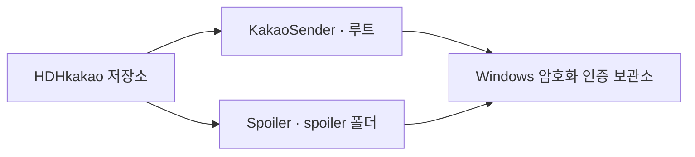

# HDHkakao · Spoiler + KakaoSender

Spoiler와 KakaoSender를 함께 관리하는 Windows 프로젝트입니다. 두 프로그램은 기존 기능과 사용자 데이터 경로를 유지합니다.

| 프로그램 | 소스 위치 | 역할 | 실행·빌드 안내 |
|---|---|---|---|
| KakaoSender · 카카오톡 Hub | 저장소 루트 | CSV/XLSX 발송, 파일 첨부, 자동 매칭, 예약 등록 | [Windows 설치](docs/SETUP.md) |
| Spoiler | `spoiler/` | 대화방별 메시지 확인, 직접 답장, 태블릿 인증 | [Spoiler 안내](spoiler/README.md) |



코드는 한 저장소에서 관리합니다. 인증 정보는 각 PC의 Windows 사용자 보관소에서 공유합니다. 비밀번호·토큰·개인 대화 내역·발송 로그·실제 예약 CSV·빌드 결과는 Git에 넣지 않습니다. 설치된 기존 Spoiler는 이 소스 복사로 교체하지 않습니다.

저장소 구성과 새 PC의 준비 순서는 [통합 프로젝트 안내](docs/MONOREPO.md)를 참고하세요.

프로젝트의 목표, 반복 오류의 원인과 해결 과정, 프로그램 구조의 변화는 [개발 기록](docs/history/README.md)에 정리했습니다. 지난 세션과 검증 자료를 대조했으며, 현재 구현과 남은 목표를 구분합니다.

## KakaoSender · 카카오톡 Hub 2.5

CSV 또는 XLSX 파일의 `카카오톡 대화명`, `텍스트`, 선택 `첨부`, 선택 `예약일시` 열을 읽어 메시지를 발송하거나 카카오톡 예약 메시지로 등록하는 Windows 보조 도구입니다.

기본값은 PC 카카오톡 화면 제어입니다. GUI의 `직접 전송`을 켜면 **예약이 없는 텍스트·이미지·파일 행**을 검증된 chat ID로 직접 전송합니다. 예약 행은 PC 카카오톡 화면으로 처리하며, 직접 전송 대상 중 끝까지 매칭되지 않은 행은 `매칭 실패`로 제외합니다.

CSV/XLSX 읽기, 미리보기에 첨부 추가, 서버 목록 조회·자동매칭과 텍스트·파일 직접 전송은 카카오톡 화면을 조작하지 않습니다. 직접 전송을 끈 화면 발송, 예약 등록, `선택 대상 PC에서 찾기`, `직접 실패 2차 전송`은 화면을 사용합니다. 화면 사용 중에는 표시줄을 확인하고 마우스·키보드 조작을 피하세요. GUI의 `화면 사용 중단` 또는 `Shift+Esc`로 중단할 수 있습니다.

직접 전송은 카카오가 공식 제공하는 제3자 API가 아닙니다. 탐지되지 않는다고 보장할 수 없고, 계정·지역·카카오톡 버전에 따라 차단되거나 동작이 바뀔 수 있습니다. 이 때문에 처음에는 OFF이며, 켤 때 위험 안내를 다시 확인합니다.

## 주요 기능

- **파일 직접 전송:** 경로 입력·파일 선택·드래그앤드롭으로 첨부를 준비하고, 직접 전송 ON에서 본문과 이미지·PDF 등 파일을 서버로 순서대로 보냅니다. 부분 전송이나 불명확한 결과는 재전송하지 않습니다.
- **발송 방식과 진행 상태:** 미리보기에서 `직접 / 화면 / 예약 등록 / 매칭 필요 / 매칭 제외`를 확인하고, 실행 중에는 대기·처리 중·성공·실패·확인·제외·재시도 건수를 따로 봅니다.
- **화면 제어 보호:** GUI의 일반 화면 전송·첨부·예약·PC 매칭·2차 전송에 사용 표시와 중단 기능을 적용했습니다. Windows 이름 있는 뮤텍스로 여러 프로세스의 화면 조작을 순서대로 처리하고, 실제 입력 직전에 대상 창 핸들(HWND), 카카오톡 프로세스(PID), 제목과 포커스를 확인합니다.
- **결과 불명 분리:** 직접 전송뿐 아니라 화면 전송·첨부·예약 등록도 발송 동작 이후 결과를 확정할 수 없는 오류가 나면 `확인 필요(unknown)`로 남깁니다. 이 행은 2차 전송 대상에서 제외합니다.
- **GUI 실행 기록 복원:** 행별 발송 시도와 결과를 작업 도중 저장합니다. 재시작 후 미시도·발송 전 중단 행과 명시적인 2차 전송 대상만 불러올 수 있으며, 같은 원본 행을 여러 복구 실행이 중복으로 이어받지 못하게 합니다.
- **연결 준비 점검:** 설치 경로·SDK 버전·인증 파일 존재 여부·좌표 설정을 확인하고 인증 복구 방법을 안내합니다. `직접 연결 확인 · 목록 조회만`은 메시지를 보내지 않고 연결을 점검합니다.
- **설치와 로그:** Python·Node 의존성 버전을 고정했고, CSV 결과 로그는 충돌 없는 파일명과 실행 ID·전송 방식 등 확장 열을 사용합니다. 설치 순서는 [Windows 설치 안내](docs/SETUP.md)를 참고하세요.

## 실행 준비

새 환경의 Python·Node 설치와 직접 전송 SDK 준비는 [docs/SETUP.md](docs/SETUP.md)를 따라 진행합니다. 아래 명령은 필요한 실행환경이 준비된 프로젝트 폴더에서 사용합니다.

```powershell
python -m pip install -r requirements.txt
```

GUI는 프로젝트 폴더에서 직접 실행합니다.

```powershell
python .\kakao_sender_gui.py
```

GUI의 텍스트 예약은 대상·본문·일시 입력과 접수 알림 확인을 자동으로 처리합니다. 저장된 예약 상세 대조는 별도로 실행할 수 있습니다. Codex나 AI API가 필요하지 않으며, GUI와 `kakao_schedule_batch.py`는 같은 예약 기록·100슬롯 카운터·중복 등록 방지를 사용합니다. 이미 접수된 행은 `기존 예약 유지`로 표시하고 다시 등록하지 않습니다. [예약 일괄 등록 안내](docs/NATIVE_RESERVATIONS.md)를 참고하세요.

2026-09-30의 Spoiler 연동·전송·예약 리팩토링 결과와 남은 구조 개선 제안은 [검토 보고서](docs/REFACTOR_REVIEW_2026-09-30.md)에 기록했습니다.

후속으로 빌드 복구·인증 런타임 선택 통일, 두 앱의 서버 인증 갱신 조율, GUI·수신 처리 책임 분리를 적용했습니다. [구현 및 검증 결과](docs/STRUCTURE_IMPROVEMENTS_2026-09-30.md)를 참고하세요. 업데이트 뒤 Spoiler를 먼저 실행하고 Hub도 다시 시작해야 양쪽이 새 인증 절차를 사용합니다.

## 입력 파일

CSV 예시:

```csv
카카오톡 대화명,텍스트,첨부,예약일시
테스트방,안녕하세요. 테스트 메시지입니다,,
테스트방,이미지 2장을 보냅니다,"C:\Users\me\Desktop\a.png;C:\Users\me\Desktop\b.png",
테스트방,,".\files\notice.pdf",
테스트방,내일 오전 예약 메시지입니다,,2026-05-27 09:30
```

지원하는 대화명 컬럼 예시: `카카오톡 대화명`, `대화명`, `채팅방`, `name`, `chat`

지원하는 텍스트 컬럼 예시: `텍스트`, `메시지`, `내용`, `text`, `message`

지원하는 첨부 컬럼 예시: `첨부`, `첨부파일`, `파일`, `파일경로`, `이미지`, `사진`, `attachment`, `file`, `image`

지원하는 예약 컬럼 예시: `예약일시`, `예약시간`, `예약`, `schedule`, `scheduled_at`, `reservation`

첨부 경로는 세미콜론(`;`), 줄바꿈, `|`로 여러 개를 넣을 수 있습니다. 상대 경로는 선택한 CSV/XLSX 파일이 있는 폴더 기준으로 해석합니다. 텍스트 없이 첨부만 있는 행도 발송할 수 있습니다. 직접 전송에서는 이미지를 한 장씩 순서대로 보내며, 화면 방식에서는 카카오톡의 기본 `묶어서 보내기` 동작을 사용합니다.

작은 crop 이미지를 사진 미리보기 대신 원본 파일로 받으려면 발송 설정 JSON의 `image_send_as`를 `"file"`로 설정하세요. 기본값은 `"photo"`이며, 직접 전송 ON의 이미지 첨부에만 적용됩니다. 바이트·확장자는 그대로 유지하고 파일 메시지로 보내므로 수신자는 파일을 열어 실제 픽셀을 확인할 수 있습니다. 화면 전송과 예약 등록에는 적용되지 않습니다.

선택 컬럼 `발송`, `send`, `enabled`를 추가하면 `no`, `0`, `미발송` 값인 행은 건너뜁니다.

`예약일시` 값이 있는 행은 카카오톡 자체 예약 메시지 창을 열어 등록을 준비합니다. 형식은 `2026-05-27 09:30`, `2026/05/27 09:30`, `2026년 5월 27일 오후 3시 10분`처럼 입력할 수 있습니다. 예약 시각은 초 없이 `00`, `05`, `10`처럼 5분 단위이며, 제출 직전에도 현재보다 최소 5분 이상 남아 있어야 합니다. 현재 예약 메시지는 텍스트만 지원하므로, 첨부 파일이 있는 행은 즉시 발송으로 사용하세요.

CSV/XLSX는 실제 헤더 행에 대화명 열과 텍스트 또는 첨부 열이 있으면 됩니다. 헤더 위쪽의 빈 줄은 자동으로 건너뜁니다. 쉼표 구분 CSV뿐 아니라 탭/세미콜론 구분 파일과 `UTF-8`, `UTF-16`, `CP949` 인코딩을 읽도록 처리했습니다. 확장자가 `.csv`여도 내부가 엑셀 파일이면 자동으로 XLSX 방식으로 읽습니다. 그래도 오류가 나면 엑셀에서 파일을 열고 `다른 이름으로 저장` → `CSV UTF-8(쉼표로 분리)`를 선택하거나, `.xlsx` 파일을 그대로 선택하세요.

## 발송 방식

| 행 종류 | 직접 전송 OFF | 직접 전송 ON |
| --- | --- | --- |
| 예약 없는 텍스트 | PC 카카오톡 화면 발송 | chat ID 직접 발송 |
| 카카오 예약일시가 있는 텍스트 | 카카오 예약창에 지금 등록 | 카카오 예약창에 지금 등록 |
| 첨부가 있는 즉시 행 | PC 카카오톡 화면 발송 | chat ID로 본문·파일 직접 발송 |

예약 행은 직접 전송 ON/OFF와 무관하게 카카오톡의 `예약 메시지` 창에 지금 등록합니다. 카카오톡에 등록한 예약은 카카오톡의 예약 기능으로 처리하며, 이 앱의 로컬 타이머로 발송하지 않습니다. API 조사와 별개로 **직접 연결을 통한 카카오 네이티브 예약 등록은 현재 구현하지 않았습니다.** 기존 화면 예약 방식을 유지합니다.

직접 전송을 쓰는 순서는 다음과 같습니다.

1. 발송 파일을 열고 `직접 전송`을 켭니다.
2. 프로그램이 태블릿 채팅 목록을 읽기 전용으로 불러와 제목/표시명이 유일한 1:1 방을 자동 연결합니다. `학생갑T → 학생갑`, `A 장성중3 학생감 → 학생감`처럼 형식이 명확한 대화명도 서버 목록에서 자동으로 비교합니다.
3. 파일을 열 때와 `발송 시작` 직전에 서버 목록을 새로고쳐 저장된 chat ID를 다시 검증합니다. 자동매칭 후에도 남은 대화명만 `수동 매칭` 창에 표시하고, 사용자가 검증된 1:1 채팅을 선택해 연결합니다. 서버 목록만으로 확인할 수 없는 경우에만 사용자가 `선택 대상 PC에서 찾기`를 눌러 PC 카카오톡 검색을 명시적으로 실행합니다.
4. 수동매칭을 마친 뒤에도 연결되지 않은 행은 발송 대상에서 제외하고 `매칭 실패`(빨간색)로 기록합니다. 그룹방·상대 identity 미확인·중복 chat ID 등 안전하게 검증할 수 없는 방도 자동 전송하지 않습니다.
5. 검증된 직접 전송 대상만 확인 창에 표시하고 발송합니다. 직접 전송 중 성공 여부가 명확한 오류가 난 행만 `직접 실패 2차 전송 (N)` 큐에 남깁니다. 사용자가 이 버튼을 눌렀을 때에만 해당 명단을 PC 카카오톡 화면 매크로로 재전송합니다. `확인 필요`는 중복 위험 때문에 이 큐에서 제외합니다.

매칭과 ON/OFF 상태는 `%APPDATA%\KakaoSender\kakao_direct.json`에 저장됩니다. 자동매칭은 현재 발송 파일의 대화명을 먼저 확정한 뒤, 같은 조회에서 받은 전체 채팅 목록 중 이름과 chat ID가 각각 유일한 나머지 방도 함께 누적 저장합니다. 화면에는 이번 회차의 `자동 매칭 확정` 수와 영구 설정의 `전체 저장` 수를 따로 표시합니다. 기존 수동 별칭과 chat ID 소유권은 자동으로 덮어쓰지 않으며, 태블릿 기본 이름으로 자동 저장된 항목만 동일 방으로 검증된 PC 별칭이 안전하게 이어받을 수 있습니다. 저장된 매칭도 다음 발송 전에 태블릿 목록의 안정적인 chat ID로 다시 검증합니다. 카카오 전체 목록의 `LCHATLIST` 페이지가 실패해도 로그인 실패로 오인하지 않고, 현재 파일에 필요한 저장 chat ID만 `CHATINFO`와 멤버 스냅샷으로 개별 검증해 계속 진행합니다. 인증 토큰은 이 파일에 넣지 않으며, 기존 `%LOCALAPPDATA%\Spoiler\loco-credentials.dat` DPAPI(CurrentUser) 보관소를 사용합니다. 자동 복구용 계정은 별도 `%LOCALAPPDATA%\Spoiler\tablet-account.dat`에 DPAPI로 암호화되며 명령줄·환경변수·로그에는 전달하지 않습니다. 채팅방 목록을 새로고칠 때는 누적 동기화 토큰 때문에 일부 최근 방만 보이지 않도록 임시 동기화 폴더에서 전체 목록을 조회하고 즉시 삭제하며, 최근 메시지 본문은 가져오거나 저장하지 않습니다. PC 보조 비교는 KakaoTalk의 `chatWindowUi.db`를 읽기 전용으로 열며, 창 위치·크기와 chat ID 외의 대화 내용은 읽거나 기록하지 않습니다. Node.js와 `agent-messenger`가 필요하며, 기본 설치 위치를 찾지 못하면 `KAKAO_NODE_PATH`, `KAKAO_AGENT_MESSENGER_ROOT` 환경 변수로 경로를 지정할 수 있습니다.

저장된 기본 이름 `학생강` 또는 숫자 명부 표기 `10917 학생개`와 현재 CSV의 `A 백신2 학생강`, `A 백석1 학생개`가 같은 유일한 2인 채팅의 동일 chat ID로 확인되면, 자동매칭은 기존 ID의 소유권을 현재 CSV 이름으로 원자적으로 승계합니다. 동명이인 채팅방이 둘 이상이거나, CSV 안에 같은 학생 이름이 둘 이상이거나, 기존 소유자가 수동/이전 학교 별칭이거나, 부분 목록에서 다른 새 chat ID가 나타나면 승계하지 않습니다. 결과 로그는 `중복 후보`, `미일치`, `저장 검증 실패`를 이름별로 따로 표시합니다.

`수동 매칭`의 `목록 새로고침`은 PC 카카오톡 창이나 키보드·마우스를 조작하지 않습니다. 서버 기본 목록과 저장 ID를 다시 읽고, 선택된 PC 계정의 읽기 전용 `chatWindowUi.db`에 있는 chat ID 카탈로그도 최대 512개까지 조회합니다. PC 메타데이터의 ID는 후보 힌트일 뿐이며, 서버 `CHATINFO`와 안정적인 멤버 스냅샷을 다시 거쳐 chat ID가 유일하고 `active_members=2`, 단일 상대 identity, 확인된 표시명을 모두 가진 1:1 채팅만 후보로 표시합니다. 따라서 카카오톡이 트레이에 있거나 해당 채팅방 창을 열어 두지 않아도 목록을 복구할 수 있습니다. 서버 표시명과 CSV의 PC 로컬 별칭이 달라 목록에서 찾을 수 없을 때만 대상을 고른 뒤 `선택 대상 PC에서 찾기`를 사용합니다. 이 명시적 동작은 확인을 받은 뒤 카카오톡 검색창에 해당 이름을 입력해 빈 메시지 상태로 방만 열고 chat ID를 확인한 후 닫으며, 메시지는 보내지 않습니다. 그룹방, MemoChat, 중복 ID, 상대 확인 불가 방, 다른 수동 별칭이 이미 소유한 방은 선택할 수 없습니다. 선택 후 CSV 대상·카카오 표시명·상대를 한 번 더 확인하면 서버에서 같은 ID를 다시 조회하고, 처음 확인한 chat ID·표시명·상대 identity가 그대로일 때만 저장됩니다. 수동으로 저장한 ID는 provenance guard로 표시되어 앱을 다시 시작해도 발송 직전 최신 상태에서 같은 2인 채팅인지 재검증하며, 확인되지 않으면 직접 전송을 차단합니다. 채팅 목록 조회가 `refresh_rejected`로 거절되면 저장된 태블릿 OAuth 갱신이 거절된 상태입니다. 자동 복구 계정이 준비된 환경에서는 Hub가 한 번 재등록하고, 준비되지 않았거나 휴대폰 확인이 완료되지 않으면 Spoiler 앱의 `태블릿 설정`에서 등록한 뒤 자동매칭을 다시 실행합니다.

상단의 화면 사용 표시줄은 항상 보입니다. CSV/XLSX 읽기, 미리보기에 첨부 추가, 서버 목록 조회·자동매칭, 텍스트·파일 직접 전송만 하는 동안은 `화면 사용 안 함`으로 유지됩니다. 일반 화면 전송·예약 등록·명시적인 PC 매칭·2차 전송에서는 화면 제어 차례를 기다린 뒤 `화면 사용 중`으로 바뀌고, 표시가 반영된 후 카카오톡 조작을 시작합니다. `화면 사용 중단` 버튼이나 `Shift+Esc`는 카카오톡에 포커스가 있어도 중단 요청을 감지합니다. 다음 입력과 발송 전에 취소를 확인하며, 정리할 때도 확인된 대상 창만 닫습니다. 프로그램 창 닫기는 진행 중인 화면 정리가 끝날 때까지 기다립니다.

목록 새로고침이 일시적으로 일부 채팅방만 반환해도, 이미 검증해 저장한 매칭은 단순 미노출만으로 지우지 않습니다. 반대로 같은 표시명이 기존 값과 다른 새 chat ID로 충돌하면 자동으로 덮어쓰지 않고 확인 대상으로 남깁니다. 설정 저장과 전체 목록 복구는 같은 프로세스 간 잠금을 사용하므로 동시에 실행되어도 복구가 중간 상태를 덮어쓰지 않습니다. PC 보조 매칭은 각 대상 처리 뒤 검색 상태를 초기화하므로 `댓글 모아보기` 같은 비채팅 화면이 열렸던 다음 대상도 깨끗한 검색 상태에서 다시 시작합니다.

텍스트 직접 전송은 서버 `WRITE`를 한 번만 시도합니다. 첨부 행은 본문이 있으면 먼저 보내고 각 파일을 한 번씩 업로드하며, 응답이 끊겼다고 같은 발송을 자동 반복하지 않습니다. 매칭되지 않은 행은 `매칭 실패`로 제외합니다. 명시적인 직접 전송 실패만 `직접 실패 2차 전송 (N)` 대상이 됩니다. 본문 또는 일부 파일이 이미 전송된 뒤 나머지가 실패한 경우와 성공 여부를 확정할 수 없는 오류는 `확인 필요`로 남기고 재시도 큐에서 제외합니다. 예약·일반 화면 전송의 오류는 직접 실패 큐에 섞지 않습니다.

GUI의 한 번의 발송 실행은 고유 실행 ID를 가진 작업으로 관리됩니다. 발송 경로에 들어가기 전에 시도를 기록하고, 행 결과는 화면에 반영하기 전에 실행 기록 저장소에 저장합니다. 화면의 행 상태와 집계는 작업 중에도 갱신되며, 최종 결과 목록은 종료 이벤트에서 한 번 확정합니다. 이전 실행에서 늦게 도착한 이벤트는 무시하고 직접 연결은 성공·취소·예외와 관계없이 한 번 정리합니다. 창 닫기는 먼저 취소와 정리를 요청하며, 화면 사용 중에는 정리를 기다립니다. 화면을 사용하지 않는 작업의 종료가 5초를 넘기면 더 기다리기·즉시 종료·창 닫기 취소를 선택할 수 있습니다.

CSV/XLSX를 열면 저장 매칭 수를 즉시 표시합니다. 모든 대상에 확인된 저장 매칭이 있으면 전체 목록 대신 이번 파일의 chat ID만 서버에서 확인합니다. 새 대상이 있거나 개별 조회 결과에 누락·중복·표시명 변경·상대 확인 실패가 있으면 전체 조회로 전환합니다. 인증·연결 오류는 캐시로 성공 처리하지 않습니다. 상단 `자동 매칭`·수동 목록 새로고침·발송 직전 검증은 전체 조회를 유지합니다. 로그의 `[매칭 시간]`에서 연결, 전체 목록, ID 조회, 정리, 결과 반영과 합계 시간을 확인할 수 있습니다.

## 1. 카카오톡 검색창 좌표 조사

카카오톡 메인 창을 열고, 대화명 검색창 위에 마우스를 올린 뒤 아래 명령을 실행합니다.

```powershell
python .\kakao_sender.py calibrate
```

좌표가 `config/kakao_sender.local.json`에 저장됩니다. 현재 마우스 좌표를 계속 보고 싶으면:

```powershell
python .\kakao_sender.py cursor
```

## 2. 발송 전 미리보기

```powershell
python .\kakao_sender.py preview --file .\examples\messages.csv
```

XLSX 파일도 사용할 수 있습니다.

```powershell
python .\kakao_sender.py preview --file .\messages.xlsx --sheet Sheet1
```

## 3. 카카오톡 메시지 발송

```powershell
python .\kakao_sender.py send --file .\examples\messages.csv
```

실행하면 `SEND`를 입력해야 실제 화면 제어가 시작됩니다. 전체 흐름은 다음 순서입니다.

1. 카카오톡 창을 맨 앞으로 올림
2. 저장된 대화명 검색창 좌표 클릭
3. 대화명 붙여넣기
4. `Enter`로 대화창 열기
5. 메시지 텍스트 붙여넣기
6. `Enter`로 전송
7. 첨부가 있으면 Windows 파일 클립보드로 파일/이미지를 붙여넣고 `Enter`로 전송
8. 열린 대화창 핸들을 직접 닫고, 실패하면 중단
9. 카카오톡 메인 창을 다시 활성화
10. 검색창 좌표 클릭 후 `Home` → `Shift+End` → `Backspace`로 검색어 비우기
11. 다음 행으로 이동
12. 전체 작업 완료 후 카카오톡 최근 대화 목록을 맨 위로 이동

## 예약 메시지 등록

CSV/XLSX의 `예약일시` 열을 채우거나 GUI 설정의 `공통 예약`을 켜면 해당 행을 카카오톡 예약 메시지로 등록합니다. 자동 등록 CLI는 다음과 같습니다.

```powershell
python .\kakao_schedule_batch.py --csv .\messages.csv --output .\exports\schedule-run --submit
```

예약 흐름은 정확한 대화명을 검색하고 `+` 메뉴의 `메시지 예약`을 연 뒤 본문·날짜·오전/오후·시·분을 입력합니다. 창의 실제 위치와 DPI를 반영하고, 네이티브 본문 읽기와 Windows OCR로 대상·전체 본문·일시를 원문과 대조합니다. 값이 일치할 때만 등록합니다. GUI의 행별 수동 확인 및 검색창 좌표 설정은 필요하지 않습니다. 등록 후 새 접수 완료 알림을 확인한 건은 `예약 접수`로 집계합니다. 기본 등록 과정에서는 예약 목록이나 저장된 상세를 다시 열지 않습니다.

제출 직전에 최소 5분 여유를 다시 검사합니다. 등록 전 실패는 `중단(stopped)`, 제출 후 결과를 확정하지 못한 건은 `예약 확인 필요(unknown)`로 구분합니다. 동일 대상·본문·시각의 제출 기록을 영구 저장하므로 CSV를 다시 열어도 성공·접수·결과 불명 행을 다시 등록하지 않습니다. 등록 저장의 검증과 예약 시각의 실제 발송·수신 확인은 구분합니다.

설정의 `예약 기록 새로 계산`은 Hub/CLI의 등록 기록과 현재 PC 시각으로 남은 100개 슬롯과 다음 해제 예상 시각을 계산합니다. 매초 갱신하며 예약 시각이 지난 건은 슬롯에서 제외합니다. CSV를 불러오기만 한 미등록 행은 세지 않고, 접수 확인·제출 결과 불명·진행 중 확보한 슬롯은 예약 시각까지 셉니다. 새 묶음이 기록상 여유보다 많으면 첫 행부터 차단합니다. 시간 경과는 실제 발송·수신 확인을 뜻하지 않으며 동일 예약의 재등록 방지 기록은 유지합니다. 재시작 후에도 기록은 유지됩니다. 카카오톡에서 수동으로 추가·삭제하거나 다른 기기에서 만든 예약은 이 계산에 반영하지 않습니다.

기존 `kakao_sender.py send --schedule-at ...` 명령은 수동 대조 방식으로 유지됩니다. 무인 등록에는 GUI 또는 `kakao_schedule_batch.py`를 사용하세요. 버전 변경·읽을 수 없는 문자·알 수 없는 팝업은 추측하지 않고 중단합니다.

## 이미지·파일 직접 전송

1. CSV/XLSX를 열거나 `행 추가`로 대화명과 메시지를 입력합니다. 파일만 보내려면 메시지는 비워도 됩니다.
2. `공통 첨부` 패널에 탐색기 파일을 드래그앤드롭하거나, 경로를 넣고 `경로 적용`을 누릅니다. 경로 입력칸·안내 문구·파일 목록·패널 여백 어디에 놓아도 파일을 지정할 수 있습니다. `파일 첨부`로 선택할 수도 있습니다. 공통 첨부는 **목록의 모든 행**에 동일하게 적용되며, 추가만으로 발송되지는 않습니다. 대상마다 다른 파일은 CSV/XLSX의 `첨부` 열로 지정하세요.
3. `직접 전송`을 켜고 자동·수동 매칭으로 대상을 확인합니다. 미리보기의 발송 방식이 `직접`인지 확인한 뒤 `발송 시작`을 누릅니다.

JPEG·PNG·GIF·WebP는 사진 메시지로, PDF·한글·Office 문서·텍스트·압축 파일 등 지원 확장자는 파일 메시지로 전송합니다. 본문이 있으면 별도 텍스트 메시지로 먼저 보내고, 파일을 입력 순서대로 하나씩 보냅니다. 여러 이미지도 한 장씩 전송하며, 본문과 파일이 하나의 메시지로 합쳐지는 방식은 아닙니다.

앱의 직접 첨부 제한은 한 행에 **최대 10개, 합계 100 MiB**입니다. 빈 파일·폴더·지원하지 않는 확장자를 차단하고 이미지의 형식·크기와 PDF 헤더를 검사합니다. 브리지는 해당 행의 모든 파일을 읽고 검사를 마친 뒤 본문 전송을 시작합니다. 각 업로드는 서버의 완료 응답과 메시지 식별자를 확인하며, 응답이 없거나 일부만 전송된 행은 `확인 필요`로 남깁니다. 이 행은 자동 재전송 및 2차 화면 전송 대상에서 제외됩니다.

직접 첨부에는 PC 카카오톡 화면이나 검색창 좌표가 필요하지 않습니다. 기존 태블릿 직접 연결 인증은 필요합니다. 파일 드롭 기능을 불러오지 못한 환경에서는 경로 입력·파일 선택을 사용하고, `requirements.txt`를 설치해 드롭 기능을 준비할 수 있습니다. 예약일시와 첨부를 함께 넣는 행은 지원하지 않습니다.

직접 전송은 기본적으로 **대상 30행을 연속 처리한 뒤 2초 쉬고 다음 30행을 처리**합니다. 개별 대상 사이에는 강제 2초 대기를 넣지 않습니다. 본문과 첨부가 여러 개여도 한 대상 행을 한 건으로 셉니다. 이 설정은 전송 속도 조절용이며 카카오가 보장하는 수량·시간 제한값을 뜻하지 않습니다.

발송 요청을 보내기 **전** 일시적인 연결 오류가 확인되면 기존 연결을 닫고 2초 뒤 새 연결을 만들어 같은 대상부터 이어갑니다. 연결 복구는 대상당 최대 두 번이며, 복구 중에도 중지할 수 있습니다. 복구가 끝내 안 되면 현재 대상과 후속 대상을 `미시도`로 남겨 [실행 기록]에서 이어서 진행할 수 있습니다. 인증 거절이나 발송 요청 후 결과가 불확실한 경우에는 자동 복구 발송을 하지 않습니다.

텍스트도 서버의 응답 상태, 양수 메시지 ID와 전송 시각을 확인해야 성공으로 기록합니다. 메시지 ID 없는 빈 응답은 `확인 필요`로 처리하고, 직접 전송 거절·불확실 응답이 나오면 후속 행은 `중단`으로 남겨 더 보내지 않습니다. `확인 필요` 행은 자동으로 재전송하지 않으며, 아직 보내지 않은 후속 행은 실행 기록의 미시도 복원에서 확인할 수 있습니다. 성공은 서버 메시지 접수 확인을 뜻하며 상대방 단말 수신·읽음 확인을 뜻하지 않습니다.

## GUI 사용

GUI는 상단의 파일·실행 버튼, 중앙 수신자 미리보기, 오른쪽 공통 첨부·발송 설정, 하단 진행·로그로 구성됩니다. 가로 또는 세로 공간이 부족하면 오른쪽 패널의 탭으로 첨부와 설정을 전환합니다. 큰 글자로 설정이 길어지면 해당 패널 안에서 세로로 스크롤할 수 있고, 키보드로 이동한 설정도 자동으로 보입니다. 수신자 표는 창 크기에 따라 늘어나며, 긴 열은 가로 스크롤로 확인할 수 있습니다. `중지`는 자동 매칭을 기다리는 발송 준비 단계부터 사용할 수 있습니다.

미리보기의 발송 방식과 대상별 내용을 확인한 뒤 실행하세요. 방식 집계는 `직접 / 화면 / 예약 등록 / 매칭 필요 / 매칭 제외`를 구분합니다. **직접 전송 ON의 예약 없는 텍스트·첨부는 서버로 전송**하며 화면 매크로를 사용하지 않습니다. OFF는 화면 전송입니다. 실행 중 집계의 `확인`은 성공 여부가 불명확한 행이며 `실패`와 별도로 표시됩니다. `테스트 1건`은 기본적으로 꺼져 있고, 체크하면 현재 목록 기준 첫 1건만 처리합니다.

`자동 매칭`은 파일을 열거나 발송 직전에 서버 목록으로 실행되며, 남은 대상은 `수동 매칭`에서 확인합니다. 끝까지 연결하지 못한 직접 전송 행은 `매칭 실패`로 제외합니다. 일반 `목록 새로고침`은 카카오톡 화면을 사용하지 않고, `선택 대상 PC에서 찾기`는 확인을 받은 뒤 PC 검색 화면을 사용합니다. 일반 화면 전송·예약·PC 매칭·2차 전송 중에는 화면 사용 표시줄과 전용 중단 버튼, `Shift+Esc`가 적용됩니다. 즉시 화면 전송에는 `화면 좌표 설정`이 필요하며 자동 예약은 실제 창과 검색 입력란을 탐지합니다.

`일시 선택`은 날짜·오전/오후·시·분을 골라 `공통 예약`에 적용하며 `가장 빠른 시각` 선택도 제공합니다. 현재 시각에서 최소 5분 뒤의 첫 5분 단위 시각을 선택하므로 실제 여유는 5분 이상 10분 미만입니다. 자정을 넘으면 다음 날의 가능한 시각부터 표시합니다. 적용 시에도 여유 시간을 다시 검사합니다. 미리보기의 `예약` 셀 더블클릭이나 `큰 창 수정`에서도 같은 선택 창으로 행별 예약을 정합니다.

CSV/XLSX 파일 선택 기본 폴더는 `Downloads`, 첨부 선택 기본 폴더는 `바탕 화면`입니다. `파일 첨부`는 선택한 파일·이미지를 모든 대화명에 동일하게 적용하고, `파일 초기화`는 모든 행의 첨부를 비웁니다. 직접 전송은 이미지를 한 장씩 보내고, 화면 전송은 카카오톡의 이미지 묶어보내기 설정을 따릅니다. 발송 시작 시 직접 전송 매칭과 화면 좌표, 예약일시, 첨부 파일을 해당 행의 방식에 맞춰 점검합니다.

발송 전 오류나 명시적인 거절은 `status=error`로, 발송 동작 이후 결과를 확정할 수 없는 오류는 `status=unknown`으로 기록합니다. 매칭 실패 행은 전송하지 않습니다. `직접 실패 2차 전송 (N)`은 명시적인 직접 실패와 아직 시도하지 않은 2차 전송 행을 대상으로 하며, 사용자가 눌렀을 때만 화면 방식으로 진행합니다. 2차 전송에서도 발송 전 실패·중단 행은 다시 대기하고, 성공·`확인 필요` 행은 재시도 대상에서 빠집니다. 메시지와 첨부 등 현재 행 데이터를 다시 점검하며, 불확실한 발송 결과를 확인하지 않고 자동 재전송하지 않습니다.

## 연결 준비 점검과 인증 복구

상단 `연결 점검` 또는 `도움말 > 연결 준비 점검 / 인증 복구`를 엽니다. 로컬 점검은 Node.js, 실제 선택된 `agent-messenger` 경로와 검증 버전, 브리지 파일, 인증 파일의 존재 여부, PC 검색창 좌표 설정을 확인합니다. 인증 내용을 출력하거나 카카오톡 화면을 조작하지 않습니다.

로컬 점검이 끝나면 `직접 연결 확인 · 목록 조회만`으로 서버 채팅 목록을 읽어 연결을 확인할 수 있습니다. 이 점검은 메시지를 보내지 않으며 발송·매칭 작업과 동시에 실행하지 않습니다. `refresh_rejected`처럼 명시적 인증 해제가 확인되고 자동 복구 계정이 준비되어 있으면 Hub가 Spoiler 인증기로 태블릿 설정을 한 번 다시 불러옵니다. 일반 네트워크 끊김에는 기존 토큰 재연결만 수행하며, 인증번호가 필요한 경우 화면에 번호를 표시합니다.

## 앱 미리보기 편집

GUI 미리보기에서는 CSV/XLSX를 다시 열지 않고도 발송 데이터를 손볼 수 있습니다. 자주 쓰는 기능은 표에서 바로 쓰고, 추가 기능은 메뉴 또는 우클릭 메뉴에 넣었습니다.

- 셀 더블클릭 또는 `Enter`: 대화명/메시지 직접 수정
- 예약 셀 더블클릭: 날짜·시간 선택 창으로 행별 예약일시 수정
- `Ctrl+F`: 미리보기 검색, `Enter`: 다음 결과, `Shift+Enter`: 이전 결과
- 오른쪽 `공통 첨부` 패널: `첨부 파일 선택`, `첨부 초기화` (우클릭 메뉴에서도 사용 가능)
- 우클릭 메뉴 또는 `편집` 메뉴: 행 추가, 복제, 삭제, 큰 창 수정
- `Ctrl+C`, `Ctrl+V`: 엑셀/스프레드시트와 TSV 형식으로 복사 및 붙여넣기
- `Ctrl+A`: 전체 행 선택
- `Ctrl+Z`: 마지막 미리보기 변경 되돌리기
- `파일` 메뉴: 편집본 CSV 저장
- 오른쪽 `발송 설정`의 `직접 실패 2차 전송 (N)` 버튼 또는 `작업` 메뉴: 명시적으로 실패한 직접 전송 행만 PC 화면 매크로로 2차 전송

## 유용한 옵션

```powershell
# 한 행씩 확인하면서 전송
python .\kakao_sender.py send --file .\messages.csv --confirm-each

# 처음 3개 행만 테스트
python .\kakao_sender.py send --file .\messages.csv --limit 3

# 5번째 메시지부터 재시작
python .\kakao_sender.py send --file .\messages.csv --start-at 5

# 모든 선택 행을 같은 시간으로 예약 등록
python .\kakao_sender.py send --file .\messages.csv --schedule-at "2026-05-27 09:30"
```

## 설정

`config/kakao_sender.example.json`을 참고해 `config/kakao_sender.local.json`을 조정할 수 있습니다.

- `search_box`: 카카오톡 대화명 검색창 좌표. 새로 좌표를 찍으면 카카오톡 창 기준 `window_offset`도 함께 저장해, 창 위치가 바뀌어도 검색창을 다시 계산합니다.
- `app_titles`: 자동 활성화할 카카오톡 창 제목 후보
- `close_chat_key`: 대화창 닫기 키, 기본값 `Alt+F4`
- `clear_search_key`: 검색창 비우기 전에 누를 키. 기본값은 빈 값이며, 현재 기본 동작은 `clear_search_strategy`를 사용합니다.
- `clear_search_strategy`: 검색창 비우기 방식, 기본값 `select_text`
- `exit_search_key`: 검색 상태나 잘못 열린 화면에서 빠져나올 때 누르는 키, 기본값 `Esc`
- `recent_list_top_key`: 전체 작업 완료 후 최근 대화 목록을 맨 위로 올릴 때 누르는 키, 기본값 `Home`
- `pre_clear_search_key`: 새 대화명을 검색하기 전에 필요할 때 먼저 누르는 키. 기본값은 빈 값입니다.
- `focus_before_each_search`: 매 행마다 카카오톡 메인 창을 다시 앞으로 올림
- `require_main_window_focus`: 카카오톡 메인 창을 못 찾으면 잘못 보내지 않고 중단
- `require_window_handles`: 메인/대화창 핸들을 못 잡으면 잘못 닫지 않고 중단
- `require_new_chat_window`: 대화명 검색 후 새 대화창이 확인되지 않으면 메시지를 붙여넣지 않고 중단
- `verify_chat_title`: 열린 대화창 제목이 대상 대화명과 공백·대소문자 정규화 후 정확히 일치하지 않으면 메시지를 붙여넣지 않고 중단합니다. 제목 끝의 ` - KakaoTalk` 또는 ` - 카카오톡` 표시는 자동으로 제외합니다.
- `allow_global_close_fallback`: 대화창 핸들 닫기에 실패했을 때 전역 `Alt+F4` fallback을 허용할지 여부. 기본값은 `false`입니다.
- `embedded_chat_close_key`: 대화창이 별도 창이 아닐 때 닫기 시도 키, 기본값 `Esc`
- `non_chat_view_close_key`: `댓글 모아보기`처럼 채팅방이 아닌 카카오톡 화면이 잘못 열렸을 때 닫는 키, 기본값 `Esc`
- `send_enter_presses`: 메시지 붙여넣기 후 누르는 Enter 횟수, 기본값 `2`
- `send_enter_interval`: Enter를 여러 번 누를 때 사이 간격, 기본값 `0.2`초
- `direct_send_batch_size`: 한 번에 직접 전송할 대상 행 수. 기본값 `30`, 허용 범위 `1`~`30`입니다.
- `direct_send_batch_pause_seconds`: 다음 직접 전송 묶음 전의 휴식. 기본값·최솟값 `2`초이며, 대기 중에도 중지할 수 있습니다.
- `press_home_before_search`: 대화명 검색 전에 최근 대화 목록에서 `Home`을 먼저 누를지 여부, 기본값 `false`
- `after_paste_attachments`, `after_send_attachments`: 첨부 붙여넣기/전송 후 대기 시간
- `after_open_schedule_menu`, `after_open_schedule_dialog`, `after_schedule_picker`: 예약 메시지 UI 조작 대기 시간
- `schedule_ui`: 대화창/예약창 기준 예약 메시지 버튼, 날짜, 시간 필드, 등록 버튼 좌표. 시간 드롭다운 내부 좌표는 자동 탐지하므로 설정하지 않습니다. 현재 대화방 제목이 `plus_button_by_chat`에 있으면 그 후보를 먼저 시도하고, 실패하면 `plus_button`, `plus_button_candidates` 후보를 순서대로 다시 시도합니다.
- `delays`: PC 속도에 맞춘 단계별 대기 시간

화면 작업은 Windows의 이름 있는 뮤텍스를 공유하므로 GUI·CLI·PC 매칭을 여러 프로세스에서 실행해도 동시에 카카오톡 화면을 조작하지 않습니다. 제어 차례를 기다리는 동안에도 GUI 중단 요청을 받을 수 있습니다. 실제 입력 직전에 대상 창의 핸들(HWND), 카카오톡 프로세스(PID), 제목과 활성 창을 다시 확인하고, 첨부 확인 창은 원래 대화창에 속하는지도 확인합니다. 대상이 바뀌면 다음 입력을 중단하며, 발송 동작 이후의 오류는 `확인 필요`로 처리합니다. 정리 중에도 확인된 정확한 창만 닫고, 기본 설정에서는 전역 `Alt+F4` fallback을 쓰지 않습니다.

## 실행 기록 복원 (GUI)

GUI는 `%LOCALAPPDATA%\KakaoSender\run-journal.sqlite3`에 실행 문서, 행별 발송 시도와 결과를 저장합니다. Windows에서는 본문·첨부 경로·결과를 담은 데이터가 DPAPI CurrentUser로 보호되어 같은 Windows 사용자 환경에서 복원됩니다. 실행 ID·시각·건수 같은 관리 정보까지 데이터베이스 전체가 암호화되는 것은 아닙니다. 저장소를 열거나 필수 기록을 저장하지 못하면 발송을 안전하게 중단합니다.

앱 시작 시 확인하지 않은 중단 기록을 안내하며, `실행 기록`에서 다음 대상을 미리보기로 불러올 수 있습니다. 불러오기만으로 발송하지 않습니다.

- `미시도 / 발송 전 중단 불러오기`: 아직 발송하지 않은 행을 새로 점검한 뒤 실행합니다.
- `2차 전송 대기 불러오기`: 명시적인 직접 실패 등 재시도가 허용된 행을 `직접 실패 2차 전송`으로 처리합니다.
- 성공·`확인 필요(unknown)`·다른 창에서 실행 중인 기록은 복구 발송 대상에서 제외합니다. 발송 시도는 기록됐지만 결과가 없으면 성공 여부를 추정하지 않고 `확인 필요`로 표시합니다.

원본 실행의 각 행은 하나의 후속 실행으로만 이어받을 수 있습니다. 같은 기록을 두 창에서 불러와도 먼저 시작한 후속 실행이 해당 행을 차지하며, 이전 기록에는 `후속 실행으로 이전`으로 표시됩니다. 후속 실행이 발송 전에 다시 중단되면 그 후속 기록에서 이어갈 수 있습니다. `기록 확인 완료`는 다음 시작의 안내를 숨기는 표시이며 기록을 삭제하지 않습니다. 현재 실행 중인 기록에는 적용할 수 없습니다.

이 내구성 기록과 복원 화면은 **GUI 발송에 통합되어 있습니다.** CLI `preview`·`send`에는 SQLite 실행 기록 복원이 적용되지 않으며, CLI 발송 결과는 CSV로 저장됩니다.

## 로그와 보관

CLI 발송 결과 로그는 기본적으로 `logs`에 저장되며, `--log-dir`로 폴더를 바꿀 수 있습니다. GUI 결과 CSV는 `%LOCALAPPDATA%\KakaoSender\logs`에 저장되고 `파일 > 로그 폴더 열기`에서 확인합니다. 파일명은 `send_log_YYYYMMDD_HHMMSS_ffffff_<UUID>.csv` 형식이며, 같은 순간에 여러 실행이 끝나도 기존 파일을 덮어쓰지 않도록 새 파일로 생성합니다.

결과 로그는 UTF-8 BOM CSV입니다. 기존 `row_index`, `row`, `chat_name`, `status`, `detail`, `attachments`, `scheduled_at` 열에 `run_id`, `transport`, `failure_stage`, `retry_transport`, `chat_id`, `log_id`를 추가했습니다. 값이 없는 항목은 빈칸이며, `run_id`로 같은 실행의 행을 묶어 확인할 수 있습니다. 이 CSV는 DPAPI 실행 기록과 별개인 평문 파일이므로 대화명·실패 사유·예약 시각 등이 남습니다. GUI 화면 로그를 따로 저장한 텍스트 파일에도 화면의 문구가 그대로 들어갑니다.

프로그램은 오래된 로그를 자동 삭제하지 않습니다. 보관 기간이 지난 파일이나 공유하면 안 되는 로그는 `logs` 폴더 또는 GUI 로그 폴더에서 직접 삭제해 주세요. 운영 기록이 필요한 경우에는 필요한 기간만 보관하고, 외부 전달 전에는 대화명과 오류 상세를 직접 확인해 민감한 내용을 제거하는 것을 권장합니다.

카카오톡 반응이 느려서 마지막 메시지가 입력창에 남으면 `delay_scale`을 `1.3`처럼 올리거나, 설정 파일의 `after_paste_message`, `after_send`, `after_close` 값을 늘리면 됩니다.

메시지 발송은 상대가 수신을 기대하는 대화방에만 사용하세요. 너무 빠르게 반복 발송하면 카카오톡 사용 정책이나 수신자에게 문제가 될 수 있으므로 소량 파일로 먼저 흐름을 확인하는 것을 권장합니다.
