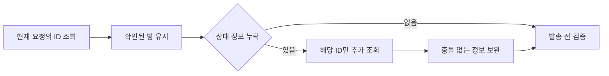

# 저장 매칭의 부분 조회 복구

## 확인 결과

사용자가 보고한 CSV의 저장 ID 51개와 서버의 1:1 상대 정보를 전수 대조했다. 당시 재검사에서는 51개 모두 정상이며 저장 설정은 변경하지 않았다. 보고 당시의 자동 매칭 로그는 화면에만 있었으므로 최초 실패 7개의 정확한 이름과 서버 응답은 복구하지 못했다.

코드에는 두 가지 부분 조회 문제가 있었다. 저장 ID 조회 일부가 실패하면 전체 목록으로 전환하면서 먼저 성공한 ID 조회 결과를 버렸다. 전체 목록에 ID만 있고 상대 정보가 없을 때에도 그 ID를 추가 조회에서 제외했다. 이후 병합 역시 같은 ID가 있으면 보완 결과를 버렸다.

## 변경

디스크 캐시를 서버 응답으로 취급하지 않는다. 같은 요청에서 확인한 결과만 보완에 사용한다. 중복 ID, 다른 상대 ID, 다른 이름, 그룹방 정보는 덮어쓰지 않는다. 확인에 실패한 방은 기존 발송 전 검사에서 계속 차단한다.

자동 매칭 결과는 앱의 로컬 로그 폴더에 `matching-latest.json`으로 저장한다. 실패 또는 미검증 대상이 있으면 `matching-last-problem.json`도 저장한다. 후속 성공은 마지막 문제 기록을 지우지 않는다. 두 파일만 유지하며 메시지 본문과 인증정보는 기록하지 않는다. 이 파일들은 공개 저장소에 올리지 않는다.

## 검증

- 51개 중 7개 상대 정보 누락: 7개만 추가 조회해 복구.
- 전체 목록에서 빠진 최초 성공 ID 유지.
- 중복·이름·상대 ID 충돌 및 검증 실패 시 발송 차단 유지.
- GUI 매칭 134개, 조회 경로 17개, 로그 2개, 기존 ID 복구 11개 통과.
- 실제 CSV와 서버 응답으로 파일 읽기 → 발송 전 검사 → 저장 후 다시 읽기를 화면 없이 재현. 51개 검증 및 전체 213개 매칭 유지.

실제 메시지 전송과 화면 조작은 수행하지 않았다.

## 후속: 저장된 학생 방이 발송 전 검사에서 빠진 경우

후속 로그는 학생 31명 중 첫 6개의 저장 ID가 최신 조회 결과에서 빠졌음을 보여 줬다. 매칭 설정에는 ID가 남아 있었다. 이 학생 방들을 ID로 조회하면 31개 모두 정상 응답했다. 실제 앱과 같은 전체 목록 조회 경로에서는 연결 끊김 응답(`CHATINFO` 상태 -1), 재연결, 전체 목록 조회 실패가 관측됐다. 최초 실패의 개별 응답 코드는 남지 않았으므로, 6개 모두의 최초 원인이 같은 연결 종료였다고 단정하지 않는다.

이전 패치는 이미 얻은 정보를 유지하는 단계만 수정했다. 이번에는 메타데이터 조회 자체의 일시적 실패를 처리했다.

- 발송 전에도 저장 ID가 모두 있으면 해당 ID를 서버에서 직접 검증한다. 전체 목록은 필요한 경우에만 조회한다.
- 연결 종료·시간 초과 등 일시적 메타데이터 조회 실패는 초기 병렬 작업 종료 후 한 번 재조회한다. 방 정보와 상대 정보를 모두 다시 검사한다. 발송 요청에는 재시도를 적용하지 않는다.
- 인증 거절, 서버의 명시적 거절, 잘못된 방 ID는 이 경로에서 재시도하지 않는다.
- 저장된 방의 조회 누락은 재매칭이나 대상 제외로 넘기지 않는다. 저장 ID를 유지하고 발송을 시작하지 않은 채 재시도를 안내한다.

패치 후 실제 앱 조회 경로로 학생 31개 모두 검증했고, 미검증 0개 및 경고 0개를 확인했다. 해당 1회 측정은 약 3.35초였다. 화면은 조작하지 않았으며 발송도 하지 않았다. 회귀 검사는 Python 152개와 Node 41개가 통과했다. 개인 이름과 ID, 원본 로그 및 서버 응답은 Git에서 제외한 로컬 `exports`에만 보관한다.
