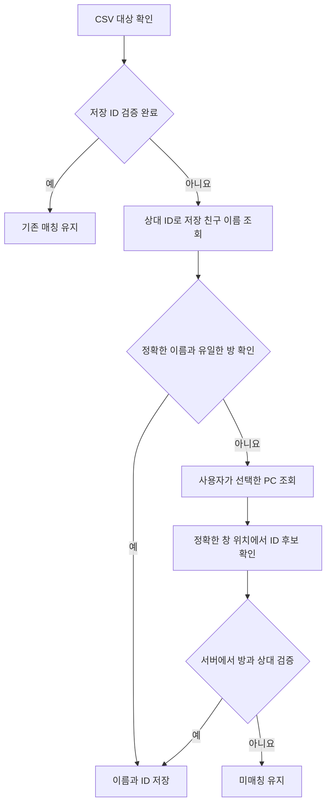

# 저장 별명과 신규 대화방 ID 복구

## 확인한 원인

ID가 저장돼 있어도, 저장 키가 공개 별명이고 CSV는 PC 저장 이름을 쓰면 연결하지 못했다. 예를 들어 저장 키가 `별명`이고 CSV 대상이 `A 학교1 학생가`인 경우다. 전체 목록의 친구 이름 조회가 비어 있는 환경에서는 서로 같은 사람임을 확인할 추가 정보도 없었다. 수동 PC 조회 역시 기존 목록에 없는 ID를 발견하면 서버에서 다시 확인하지 않고 버렸다.

## 변경한 처리

기존 ID를 빠르게 검증한 요청은 추가 친구 조회를 하지 않는다. 미매칭 요청은 이미 검증한 1:1 상대의 친구 정보를 GET으로 읽는다. 공개 별명과 PC 저장 이름이 달라도, 같은 상대 ID에 연결된 정확한 저장 이름을 받으면 연결할 수 있다. 문자열 유사도나 부분 일치로 사람을 추정하지 않는다.

기존 공개 별명 키를 새 이름으로 바꾸려면 ID의 소유자가 현재 서버 표시명과 같아야 한다. 수동 보호된 ID와 다른 현재 CSV 대상의 ID는 자동으로 넘기지 않는다. 실제 방 ID와 검증용 서버 표시명은 유지한다. 중복 별명, 중복 ID, 서로 다른 상대 정보도 통과하지 않는다.

PC 조회 중 새로 나타난 ID는 읽기 전용 창 메타데이터에서 정확한 위치가 하나만 일치할 때 후보가 된다. 서버에서 같은 ID의 2인 대화방과 상대를 검증해야 저장 단계로 전달한다. 창 닫기 실패나 취소가 발생하면 해당 후보를 전달하지 않는다. 화면 조작은 기존의 명시적 PC 조회에서만 실행한다.

## 검증 범위

- 새 복구 검사 11개: 별명 승계, 보호된 소유자, 중복·상대 불일치, 저장 후 재읽기, 새 ID의 서버 검증과 저장, 취소와 창 정리 실패.
- 기존 자동·수동 매칭 134개, 직접 연결 24개, 저장 매칭 지연 13개, 명단 갱신 26개, 학부모 매칭 6개, 후보 표시 9개 통과.
- Node 메타데이터·친구 이름·상대 정보 검사 42개 통과.
- 실제 대상 1개의 방 ID, 상대 ID, 정확한 저장 이름을 서버에서 확인했다. 원본 설정을 백업한 뒤 이름을 변경하고 나머지 212개 매칭을 보존했다.

이번 검증에서는 실제 PC 창을 조작하지 않았다. 화면 경로는 목업으로 검사했다. 실제 서버에서는 메타데이터만 조회했다. 메시지와 파일은 전송하지 않았다. 개인 이름·ID와 백업 기록은 Git에서 제외한 로컬 자료에 보관한다.
