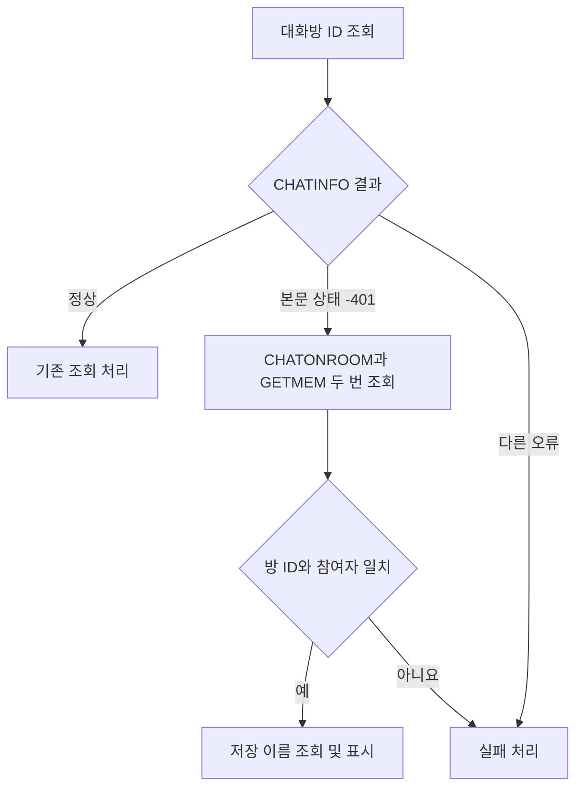

# 새 1:1 대화방의 이름과 ID 조회

## 확인한 문제

메시지가 없는 새 1:1 대화방은 `CREATE`로 ID를 받은 뒤에도 `CHATINFO`에서 본문 상태 `-401`을 반환할 수 있다. 같은 방의 `CHATONROOM`과 `GETMEM`은 정상 응답을 반환했다. 첫 `CHATONROOM`에 있던 선택 필드 `a`는 같은 연결의 다음 응답에서 생략되기도 했다.

이 때문에 실제로 존재하는 방을 KakaoSender와 Spoiler가 조회 실패로 처리했다. 연결이 끊긴 뒤 같은 세션 객체를 계속 쓰면 조회도 끝나지 않았다.

## 적용한 처리

학부모 대화방도 학생 대화방과 같은 영구 이름–ID 매칭에 저장한다. `어머님`, `아버님`, `보호자` 같은 공통 호칭은 사람 이름으로 분리하지 않는다. 예를 들어 `B 학교1 학생가 어머님`과 `B 학교2 학생나 어머님`은 서로 다른 이름이다. 호칭이 같다는 이유로 중복 대상으로 처리하거나 학생 본인의 방으로 연결하지 않는다.

매칭 키는 확인한 PC 저장 이름이다. `mapping_labels`는 서버에서 확인한 표시명을 보관하므로 PC 이름과 다를 수 있다. 이 표시명은 재검증에 사용한다. 화면 표시를 맞추기 위해 검증 기록을 덮어쓰지 않는다. 개인의 실제 이름·ID 목록은 로컬 설정에만 저장하며 공개 Git에는 올리지 않는다.

대체 조회는 정확한 `DirectChat` 유형과 참여자 두 명을 요구한다. 두 명 중 한 명은 현재 계정이어야 한다. 방 ID, 참여자 ID, 두 번의 조회 결과가 모두 같아야 한다. 일반 단체방과 다른 계정의 방은 통과하지 않는다.

- `bridge/kakao_direct_metadata.mjs`를 두 프로그램이 함께 사용한다.
- 연결 종료를 SDK가 확인한 경우에만 새 세션에서 전체 검사를 한 번 다시 시작한다. 서로 다른 세션의 일부 결과를 합치지 않는다.
- 참여자 불일치와 취소는 다시 시도하지 않는다.
- 대체 조회는 개인이 지정한 대화방 제목의 삭제를 증명하지 못한다. 따라서 기존의 우선순위가 높은 제목을 지우지 않는다.
- KakaoSender의 전체 목록 조회와 개별 ID 조회에 같은 참여자 검증을 적용한다.
- Spoiler 빌드 기록에 공통 모듈의 해시도 포함한다.

## 검증과 적용

관련 Node 검사 82개가 통과했다. Spoiler 전체 브리지 검사 165개와 저장소·통합·UI·내장 런타임 검사가 통과했다. 첫 전체 검사는 샌드박스가 임시 파일 교체와 하드링크 생성을 막아 실패했다. 같은 검사를 일반 사용자 환경에서 실행해 통과를 확인했다.

학부모 매칭 검사 6개도 통과했다. 저장 후 다시 읽기, 기존 학생 매칭 유지, 서버 표시명이 다른 방의 재검증, 일부 방을 확인하지 못한 경우의 전송 차단을 검사했다. 실제 로컬 설정에는 학부모 62개를 포함한 매칭 213개가 있다. 이번 CSV의 68개 대상은 모두 앞서 검증한 ID와 일치했다. 이 최종 저장 검사는 서버를 다시 조회하거나 메시지를 보내지 않았다.

승인된 21개 방은 실제 서버에서 이름과 상대 ID를 다시 검증했다. 검증용 연결은 조회 명령만 허용했다. 메시지 전송, 파일 전송, 방 생성, 읽음 신호 명령은 허용하지 않았다.

실제 이름과 ID, 검증 기록, 백업 경로는 Git에서 제외한 로컬 `exports`에 보관한다. Spoiler 이름 캐시는 기존 암호화 저장 API로 갱신했다. 저장 전후 기존 메시지 1,000개의 내용이 같은지 확인했다. 실행 파일도 백업한 뒤 교체하고 SHA-256을 대조했다.

새 대화방을 자동으로 생성하는 제품 기능은 추가하지 않았다. 이번 생성은 사용자가 승인한 대상의 일회성 준비 작업이었다.
