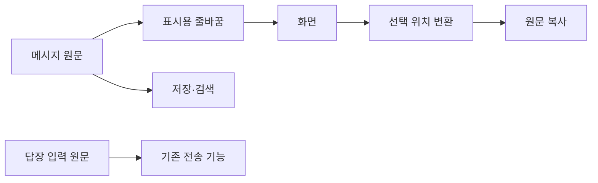

# 한국어 줄바꿈 패치 · 2026-10-09

KakaoSender와 Spoiler에 한국어 줄바꿈 원칙을 적용했습니다. 기존 Tkinter·ttk와 WPF를 유지했습니다. 새 UI 라이브러리를 추가하지 않았습니다. 실제 메시지를 보내거나 예약하지 않았습니다.

| 화면 요소 | 적용한 표시 규칙 |
|---|---|
| KakaoSender 안내·상태·경로 | 띄어쓰기에서 먼저 줄을 넘깁니다. 긴 단어와 경로는 화면 안에서 나눕니다. |
| KakaoSender 짧은 안내 제목 | 줄 수를 늘리지 않는 범위에서 길이를 맞춥니다. |
| KakaoSender 본문 안내 | 마지막 줄에 단어 하나가 남으면 앞줄의 단어를 옮깁니다. 들어갈 공간이 있을 때만 적용합니다. |
| Spoiler 받은 메시지·안내 | 들어갈 수 있는 한국어 단어는 중간에서 자르지 않습니다. 너무 긴 단어와 URL은 나눕니다. |
| 버튼·시간·대화방 제목 | 한 줄을 유지합니다. 대화방 제목의 기존 말줄임 표시를 유지합니다. |
| 메시지·답장 입력 | 원문의 공백과 직접 입력한 줄바꿈을 유지합니다. 입력창에는 표시용 문자를 넣지 않습니다. |

CSS를 직접 넣은 패치는 아닙니다. KakaoSender에서는 글꼴의 실제 폭으로 안내 라벨을 배치합니다. 측정 결과는 라벨마다 최대 512개까지 보관합니다. 입력창의 기존 `wrap="word"`는 유지합니다.

Spoiler의 기본 WPF 줄바꿈은 한국어 단어도 음절 사이에서 나눕니다. `WrapWithOverflow`만 설정해도 이 문제가 남았습니다. 그래서 읽기 전용 표시에는 보이지 않는 WORD JOINER를 사용합니다. 선택한 내용을 복사할 때는 원문 위치로 되돌립니다. 한국어 UI 글꼴은 맑은 고딕으로 맞췄습니다.

줄바꿈 처리는 화면에만 적용합니다. 저장·검색·CSV·전송 경로에 표시용 문자열을 전달하지 않습니다. WPF의 접근성 Value 패턴도 원문을 반환합니다. Text 패턴의 내부 범위는 표시 문자열을 기준으로 동작합니다.

WPF에는 CSS의 `balance`·`pretty`를 그대로 적용하지 않았습니다. 이 두 방식의 간단한 보정은 KakaoSender 안내 라벨에만 적용했습니다. WPF 답장 입력창은 기존 편집 방식을 유지합니다.

| 프로젝트 | 변경 파일 |
|---|---|
| KakaoSender | `kakao_gui_text.py` 추가, `kakao_sender_gui.py`, `kakao_gui_panels.py` |
| KakaoSender 검사 | `tests/test_kakao_gui_korean_text.py` 추가 |
| Spoiler | `src/KoreanText.cs` 추가, `src/MainWindow.cs`, `src/MainWindow.RoomPresentation.cs`, `src/KakaoRegistrationWindow.cs` |
| Spoiler 검사·빌드 | `test/KoreanWrappingTests.cs` 추가, `test/RoomUiFixtures.cs`, `test/UiContractTests.cs`, `test/RoomRenderingTests.cs`, `test/ResponsivenessTests.cs`, `test/RoomUiPreview.cs`, `build.ps1` |

KakaoSender는 Python 구문 트리도 대조했습니다. 기존 두 파일의 변경은 안내 라벨 교체와 그에 필요한 가져오기뿐입니다. 전송 처리, API 호출, 데이터 구조와 파일 형식은 바꾸지 않았습니다. Spoiler의 나머지 기존 C# 원본 파일은 변경 전 해시와 일치합니다.

최종 검사는 다음과 같습니다.

- KakaoSender: 새 줄바꿈 검사 6개 통과. 기존 화면·드롭·미리보기·상태 검사 29개와 하위 검사 3개 통과. 최종 검사에서 건너뛴 항목은 없습니다.
- Spoiler: 한국어 표시·복사·접근성·초안 검사 63개, 기존 화면 검사 92개, 재사용 검사 28개, 디자인 상태 검사 47개 통과. 메시지 병합 400개 배치 검사도 통과했습니다.
- Spoiler 전체 빌드: bridge 검사 157개, 기존 저장·답장·런타임 검사 통과.
- 실제 WPF 화면: 760×800과 1440×900에서 합성 대화방을 렌더링하고 확인했습니다. 실제 대화는 확인하지 않았습니다.
- Spoiler 설치: 사용자가 트레이 종료를 확인한 뒤 설치본을 교체했습니다. 빌드 파일과 설치 파일의 SHA-256이 일치합니다. 이전 실행 파일은 빌드 폴더에 백업했습니다.

성능 비교는 실행별 편차가 컸습니다. 변경 전 실행은 시간 제한에 도달했습니다. 최종 코드의 1,000건 합성 자료 검사는 통과했습니다. 이번 줄바꿈 패치를 속도 개선으로 단정하지 않습니다.

검사 기록은 [verification.json](../exports/korean-wrap-20261009/verification.json)에 있습니다. 화면은 [좁은 창](../exports/korean-wrap-20261009/spoiler-korean-760.png)과 [넓은 창](../exports/korean-wrap-20261009/spoiler-korean-1440.png)에 있습니다.

설계 참고는 사용자가 제공한 [한국어 줄바꿈 설명](https://www.threads.com/@ddal_kkak_/post/DeLA4z6E3jC)입니다. 구현 확인에는 Microsoft의 [WPF TextWrapping](https://learn.microsoft.com/dotnet/api/system.windows.textwrapping) 문서를 사용했습니다. 외부 코드를 복사하거나 새 디자인 자산을 가져오지 않았습니다. 기존 출처·라이선스 고지는 유지했습니다.
