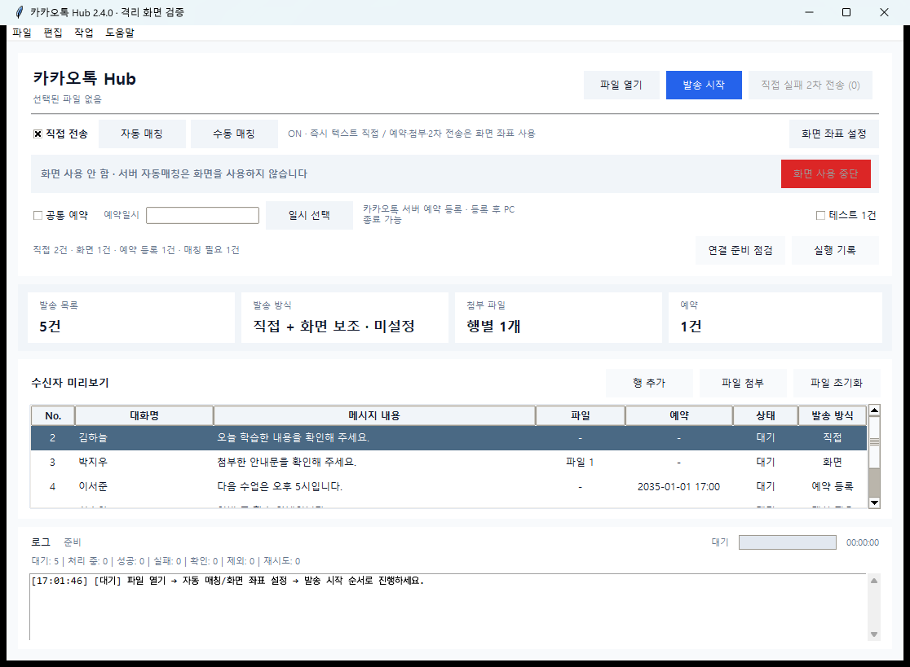

# 카카오톡 Hub 2.4.0 구현 및 검증

2026-09-05 프로젝트 검토에서 권장한 제품 개선 1~5단계를 구현했습니다. 기존 사용자 설정과 DPAPI 인증 보관소 경로를 유지합니다.

## 반영 내용

| 순서 | 구현 결과 |
| --- | --- |
| 1. 문서 보존 | 붙여넣기 전체를 검증한 뒤 한 번에 반영합니다. 새 파일을 읽지 못하면 기존 경로·명단·결과·되돌리기 기록을 보존합니다. |
| 2. 발송 결과와 중단 | 발송 동작 이후 화면 정리·연결 오류는 `확인 필요`로 분리하고 2차 전송에서 제외합니다. 일반 화면·첨부·예약·2차 전송에 화면 사용 표시와 Shift+Esc 취소를 연결했습니다. |
| 3. 화면 제어 직렬화 | 같은 Windows 사용자 세션의 GUI·CLI·PC 조회가 공통 named mutex를 사용합니다. 대기 중 취소와 보유 프로세스 종료 후 회수를 지원합니다. 입력 직전 HWND·PID·KakaoTalk 프로세스 및 포커스를 다시 확인하고 확보한 대상 창만 닫습니다. |
| 4. 매칭·브리지·기록 | GUI와 CLI의 보호 매칭 라벨 정책을 통합했습니다. 브리지 재시작은 새 인증 세대로 처리하며 전송 요청을 재실행하지 않습니다. CSV 이름 충돌을 막고 GUI의 행별 시도·결과를 SQLite에 즉시 저장합니다. |
| 5. 운영 화면과 구조 | 행별 발송 방식·확인창 집계·진행 중 7종 카운터·연결 준비 점검·실행 기록 복원을 추가했습니다. 작은 창에서는 상태 카드를 접어 미리보기와 조작부를 유지합니다. 의존성을 고정하고 문서·매칭 정책·실행 서비스를 Tk에서 분리했습니다. |

## 실행 기록 사용

`실행 기록`에서 미시도·발송 전 중단 명단 또는 명시적으로 실패한 2차 전송 대기를 불러옵니다. 불러오기 자체는 발송하지 않습니다. 성공·확인 필요·현재 실행 중인 행은 복원 발송에서 제외합니다.

복원된 행의 원본은 편집·삭제·부분 실행 후에도 유지됩니다. 후속 실행으로 넘긴 행은 부모 기록에서 다시 발송할 수 없고, 후속 실행의 결과에서 이어서 진행합니다. 두 앱이 같은 행을 동시에 복원해도 원자적 기록으로 한 번만 인계합니다. 새로 추가한 행은 새 작업으로 취급합니다.

Windows 기록의 명단·본문·결과는 DPAPI CurrentUser로 보호되며 `%LOCALAPPDATA%\KakaoSender\run-journal.sqlite3`에 저장됩니다. 인증정보는 이 기록에 넣지 않습니다. 시도 기록은 있지만 결과가 없는 행은 `확인 필요`로 복원합니다. 저장 실패 시 추가 발송을 막고 재시작 후 기록과 대화방 확인을 안내합니다. 행별 SQLite 복원은 GUI 기능이며 CLI는 CSV 결과 로그를 사용합니다.

## 검증 결과

- 검증한 새 Windows 가상환경: CPython 3.12.10, Node.js 24.19.0, agent-messenger 2.37.1.
- 전체 Python 검사: **422 passed, 1 skipped, 47 subtests passed**. 제외된 1개는 POSIX 파일 권한 전용 검사입니다.
- Node 검사: **31 passed**. Python 전체 검사에도 Node 테스트 실행을 확인하는 래퍼가 포함됩니다.
- 새 임시 환경에서 Python 고정 의존성 설치 및 `pip check`, Node `npm ci --ignore-scripts`와 SDK 인터페이스 import 성공.
- 실제 프로세스 간 잠금·대기 취소·보유자 종료 후 복구, 복구 행의 동시 인계 경쟁을 합성 데이터로 검증했습니다.
- 격리된 APPDATA/LOCALAPPDATA와 가짜 전송 서비스로 실제 Tk 창을 검증했습니다. 1100×760 및 최소 900×560에서 미리보기·방식 열을 확인했고, 진행 집계·실행 기록·연결 진단 창의 표시와 Tk 오류 0건을 확인했습니다.
- 실제 계정 로그인·메시지 발송·카카오톡 화면 조작은 수행하지 않았습니다. 외부 클라이언트와의 실제 발송 결과를 입증한 검증은 아닙니다.

입력 직전 창 재검증과 입력 사이의 매우 짧은 간격까지 전역 키보드 자동화가 원자적으로 보장하지는 않습니다. 예약은 기존 카카오톡 화면 등록 경로를 유지하며, 비공개 프로토콜을 이용한 직접 예약 연구는 별도 실험 범위입니다.

## 코드와 실행

- 문서 편집: `kakao_document.py`
- 매칭 정책·카탈로그: `kakao_mapping_policy.py`, `kakao_chat_catalog.py`
- 실행 서비스·수명주기: `kakao_send_service.py`, `kakao_send_run.py`
- 화면 잠금·전송: `kakao_pc_lease.py`, `kakao_sender.py`
- 실행 기록·진단: `kakao_run_journal.py`, `kakao_diagnostics.py`
- GUI: `kakao_sender_gui.py`

[설치 안내](SETUP.md) · [사용법](../README.md)

아래는 합성 명단을 사용한 자체 창 캡처입니다.

로컬 검증 원본은 Git에서 제외한 `review_artifacts/2026-09-05/`의 `final_pytest.xml`, `install_validation.json`, `gui_24_smoke.json`과 테스트별 JSON에 보관합니다.
