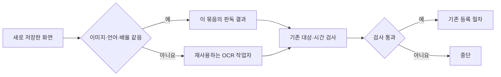

# 예약 등록 속도 개선 · 2026-10-10

예약 등록에서 반복하던 OCR 준비 작업을 줄였습니다. KakaoSender를 다시 실행하면 예약 묶음 전체가 하나의 OCR 작업자를 사용합니다. 대상·본문·날짜·시간 검사와 접수 알림 확인은 유지합니다.

최근 성공한 한 예약의 로그에서는 전체 작업에 25.55초가 걸렸습니다. OCR 호출에 해당하는 구간은 약 20.50초였습니다. 기존 코드는 이미지마다 PowerShell 프로세스를 새로 만들고 Windows OCR 엔진을 준비했습니다.

이미지 파일의 전체 내용이 같을 때만 판독 결과를 재사용합니다. 언어와 배율도 같아야 합니다. 새 화면을 저장하는 과정은 생략하지 않습니다. 파일 이름이나 수정 시각만 보고 같은 이미지로 판단하지 않습니다.

검증 내용은 다음과 같습니다.

| 검증 | 결과 |
|---|---|
| 저장된 성공 예약의 OCR 13회 · 기존 방식 | 23.44초 |
| 같은 이미지·언어·배율 · 새 방식 | 1.97초 |
| OCR 시간 감소 | 91.6% |
| 글자와 원본 이미지 좌표 | 13회 모두 같음 |
| 추가 언어·배율 검사 | 기존 결과와 같음 |
| 저장된 오류 양식 3개 재판독 | 대상과 저장된 양식 시각이 모두 같음 |
| 회귀 검사 | 테스트 139개와 하위 검사 78개 통과 |
| 기존 단일 이미지 호출 | 호환 유지 |
| 손상된 이미지 요청 | 거부 후 다음 정상 이미지 판독 가능 |

새 방식의 시간에는 첫 작업자 실행과 엔진 준비 시간도 포함합니다. 측정은 저장된 이미지를 순서대로 읽는 검사입니다. 실제 예약 등록 전체를 다시 실행한 측정은 아닙니다. 창 열기, 입력, 화면 저장과 카카오톡 응답 시간은 따로 필요합니다. 첫 이미지는 작업자 준비에 약 1.77초가 걸렸습니다. 이후 새 이미지 판독은 이 검사에서 대체로 0.01~0.03초가 걸렸습니다.

작업자는 예약 묶음 안에서만 사용합니다. 이미지 결과는 최대 128개를 보관합니다. 작업이 끝나면 결과를 비우고 작업자 프로세스를 닫습니다. 다른 스레드의 OCR 작업에는 영향을 주지 않습니다. 작업자 밖에서 호출하는 기존 OCR API도 유지합니다.

응답의 요청 ID와 결과 형식을 검사합니다. 잘못된 응답, 시간 초과, 작업자 종료 또는 취소는 중단 사유입니다. OCR 처리 중 입력 파일이 바뀌면 결과를 사용하지 않습니다. 예약 등록을 자동으로 재시도하는 기능은 추가하지 않았습니다. 기존의 중복 등록 방지와 등록 결과 기록도 그대로 사용합니다.

변경 파일은 다음과 같습니다.

- `kakao_ocr_worker.py`: 예약 묶음의 OCR 작업자, 요청 확인, 제한된 결과 보관, 종료 처리.
- `kakao_windows_ocr.py`: 호출 문맥에 따른 작업자 연결. 기존 공개 함수의 인자는 유지.
- `scripts/kakao_windows_ocr.ps1`: 반복 요청 처리와 언어별 OCR 엔진 재사용. 기존 단일 이미지 실행도 유지.
- `kakao_native_schedule.py`: 예약 작업자 연결과 종료. 작업자 종료에서 오류가 나도 입력·DPI 설정을 복구.
- `tests/test_kakao_ocr_worker.py`: 재사용, 파일 변경, 언어·배율 분리, 잘못된 응답, 취소, 시간 초과, 종료 검사.

검증 기록과 변경 전 파일은 `exports/reservation-speed-20261010`에 있습니다. `benchmark.json`의 작업자 요청 수에는 추가 언어·배율 검사 2회도 포함합니다. 실제 카카오톡 예약 목록 조회, 새 예약 등록, 발송, 사용자 예약 기록 수정은 수행하지 않았습니다.
