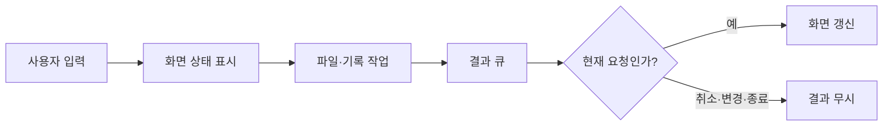

# 사용자 반응 속도 개선

현재 로컬 KakaoSender의 화면 작업을 개선했다. Python과 Tkinter/ttk를 유지했다. 새 UI 라이브러리는 설치하지 않았다.

## 사용자에게 보이는 변화

| 작업 | 변경 |
|---|---|
| 프로그램 시작 | 버튼 이미지를 픽셀마다 쓰지 않고 같은 색의 행 구간으로 그린다. 기존 픽셀과 투명 모서리를 유지한다. |
| CSV·XLSX 열기 | 파일을 작업 스레드에서 읽는다. 화면에 읽기 상태를 바로 표시한다. 중지할 수 있다. 연속으로 파일을 고르면 마지막 파일만 적용한다. |
| 행 편집·삭제·되돌리기 | 변경한 행만 갱신한다. 이전 실행 색상은 지운다. 행 번호와 발송 경로를 유지한다. |
| 행 선택 | 선택할 때 공통 첨부 목록을 다시 만들지 않는다. 아직 적용하지 않은 경로 입력은 유지한다. |
| 검색 | 행의 검색용 텍스트와 같은 검색어의 결과를 재사용한다. 수정한 행, 검색어 지우기, 검색창 닫기를 반영한다. |
| 발송 전 점검 | 같은 첨부의 존재 여부와 직접 첨부 검증을 한 번씩 수행한다. 다음 실행에서는 다시 검사한다. |
| 발송 경로 표시 | 매칭과 제외 이름을 묶어서 계산한다. 같은 경로 셀은 다시 쓰지 않는다. |
| 진행 표시 | 결과를 순서대로 보존한다. 요약, 진행률, 상태, 로그 삽입과 표 스크롤은 묶어서 표시한다. |
| 수동 매칭 | 마지막 검색 입력을 120ms 뒤에 처리한다. 큰 후보 목록을 나누어 표시한다. 표시 중에는 연결을 막는다. |
| 실행 기록·복구 | 기록을 작업 스레드에서 읽는다. 기록 창은 먼저 연다. 큰 표는 나누어 표시한다. |
| 예약 카운터 | 주기 조회와 새로 계산을 작업 스레드에서 처리한다. 오래된 조회가 최신 서비스 표시를 덮지 못하게 막는다. |
| 편집본 CSV 저장 | 저장할 내용을 고정한 뒤 작업 스레드에서 쓴다. 같은 프로그램의 저장 요청은 순서대로 처리한다. 실제 쓰기 완료 후 완료 로그를 표시한다. |
| 창 크기 변경 | 중복 크기 설정과 재진입을 줄인다. 글의 높이가 바뀌면 배치를 다시 계산한다. |

로그 저장용 비동기 진입점도 추가했다. 기존 화면에는 로그 저장 버튼이 없으므로 새 버튼은 추가하지 않았다. 기존 동기 `reload_file`, `refresh_schedule_capacity`, `save_preview_csv`, `save_visible_log` 진입점은 유지했다.

## 화면과 작업 스레드

작업 스레드는 Tk 위젯을 변경하지 않는다. 화면 갱신은 GUI 스레드에서 한다. 파일 쓰기를 이미 접수했다면 창을 닫아도 그 쓰기는 끝낸다.

진행 큐는 한 번에 최대 64개를 처리한다. 약 8ms가 지나면 다음 GUI 차례로 넘긴다. 단일 이벤트와 마지막 표시 처리의 시간은 이 예산을 넘을 수 있다. 결과 순서는 바꾸지 않는다. 확인창과 종료 결과 앞에서 앞선 표시를 적용한다.

## 유지한 기능과 안전 조건

- CSV의 열, 인코딩, BOM과 줄바꿈을 유지했다.
- 메시지, 첨부, 예약 데이터와 서버 API 형식을 바꾸지 않았다.
- 수신 대상 확인과 저장 전 최신 채팅 검증을 유지했다.
- 발송 간격, 수신 확인, 예약 확인과 재전송 제한을 유지했다.
- 파일 읽기 실패 시 기존 파일, 명단과 결과를 유지한다.
- 취소하거나 닫은 조회의 결과는 화면에 적용하지 않는다.
- 실제 발송 전 첨부 검증과 실행 시작 시 파일 복사를 유지했다.
- 실행 기록 저장소 초기화, 설정의 확정 저장과 종료 결과 CSV 저장은 기존 확정 절차를 유지했다.

## 측정

아래 값은 합성 데이터의 로컬 측정이다. 카카오톡 서버 처리 시간이나 실제 사용자의 체감 시간을 측정한 값은 아니다.

| 검사 | 이전 | 이후 | 조건 |
|---|---:|---:|---|
| 셀 하나 수정 | 27.310ms | 14.466ms | 실제 Tk 표, 1,000행, 콜백과 Tk 배치, 7회 중앙값 |
| 같은 검색 20회 | 13.234ms | 0.055ms | 같은 표와 전체 본문 검색, 7회 중앙값 |
| 진행 이벤트 처리 | 503.070ms | 20.820ms | 모의 위젯, 1,000행·4,000이벤트, 5회 중앙값; 표시 스케줄 대기 제외 |
| 발송 경로 계산 | 43.780ms | 0.565ms | 1,500행·1,500매칭·제외 100개, 5회 중앙값 |
| 수동 후보 계산 | 212.090ms | 22.457ms | 4,000방·4,000매칭, 전체 후보 필드 비교, 5회 중앙값 |
| 버튼 이미지 생성 | 108.133ms | 51.630ms | 실제 Tk 이미지 80개, 5회 중앙값 |
| 느린 저장 요청의 GUI 반환 | 300.434ms | 0.392ms | 쓰기를 300ms 지연한 모의 검사, 5회 중앙값 |

느린 저장의 실제 완료는 약 300.937ms 뒤에 확인했다. 쓰기 속도가 빨라졌다는 뜻은 아니다. 쓰기를 기다리는 동안 화면이 반응한다는 뜻이다.

`exports/response-optimization-20261007/preview-benchmark.json`에 실제 Tk 측정 표본을 저장했다. `benchmark-preview.py`로 재현할 수 있다. 비교 기준 소스는 같은 폴더의 `before`에 보존했다.

## 변경 파일

- `kakao_sender_gui.py`: 비동기 UI 진입점 연결, 검색·표·첨부 선택·로그·배치 갱신 개선.
- `kakao_gui_loading.py`: 파일과 예약 기록 조회, 취소와 오래된 결과 처리.
- `kakao_gui_exports.py`: 고정한 CSV·로그 내용의 순차 저장.
- `kakao_gui_feedback.py`: 순서를 유지하는 분할 큐 처리와 표시 묶음.
- `kakao_gui_panels.py`: 기록·복구 조회와 기록 표의 분할 표시.
- `kakao_gui_matching.py`: 후보 검색 지연과 표의 분할 표시.
- `kakao_mapping_policy.py`: 검증한 매칭 소유자 색인의 단일 생성.
- `kakao_delivery.py`: 전체 경로 계산용 색인.
- `kakao_gui_theme.py`: 같은 픽셀을 적은 Tk 쓰기 호출로 생성.
- `kakao_sender.py`: 한 사전 점검 안에서 같은 첨부의 존재 확인을 재사용.

검사 결과와 검사 범위는 `exports/response-optimization-20261007/verification.json`에 기록한다. 실제 메시지 발송과 예약 등록은 수행하지 않았다.
