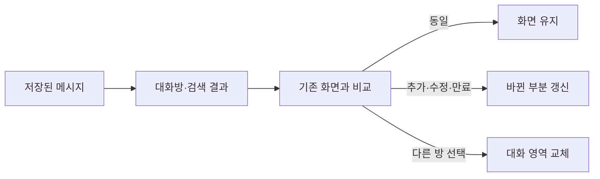

# Spoiler 디자인·화면 반응 개선

## 적용 범위

기존 C# WPF 앱을 유지했다. 추가 UI 라이브러리는 없다. 실제 메시지 수신·직접 답장 API와 저장 형식은 유지했다. 이번 검사는 가상 계정과 가상 대화만 사용했다. 사용자의 실제 메시지는 읽거나 보내지 않았다.

원본 프로젝트: `C:\Users\gkseh\OneDrive\문서\ChatGPT\Spoiler (카톡 몰읽)`.

검사 자료: `exports/spoiler-design-response-20261007`.

원본 프로젝트의 소스와 새 빌드를 적용했다. 설치된 앱은 실행 중이다. 설치 실행 파일의 교체는 앱 종료를 기다린다. 창의 X 버튼은 앱을 숨기므로 알림 영역 메뉴의 ‘종료’를 사용해야 한다. 기존 대화·설정 파일과 자동 시작·바로가기는 바꾸지 않았다.

## 디자인

- 대화방 목록과 대화 본문을 구분했다. 흰색 수신 말풍선과 노란색 발신 말풍선을 유지했다.
- 색상, 글자, 간격, 테두리, 모서리를 공통 토큰으로 관리한다. 본문은 14.5 DIP, 시간 등 보조 정보는 12.5 DIP다. DIP는 WPF의 화면 배율에 따라 확대되는 크기 단위다.
- 버튼은 기본, 마우스 오버, 누름, 키보드 포커스, 비활성, 전송 중 상태를 구분한다. 상태가 바뀌어도 버튼 크기는 바뀌지 않는다.
- 입력 필드는 키보드 포커스 테두리를 표시한다. 닫기 버튼은 빨간 마우스 오버 색을 유지한다.
- 장식용 크기·등장 애니메이션을 제거했다. 수신 상태, 전송 결과, 입력 내용은 그대로 표시한다.
- 메시지 본문은 선택·복사가 가능한 읽기 전용 TextBox다. Tab은 메시지 본문을 건너뛴다. 많은 메시지가 있어도 조작 필드에 빠르게 도달한다.

## 화면 갱신

같은 방의 새 메시지는 기존 말풍선을 유지하고 필요한 부분만 바꾼다. 다른 방의 메시지는 현재 대화의 본문을 다시 만들지 않는다. 방 ID, 시간순, 내 메시지 필터, 검색 조건, 초안, 스크롤 위치는 기존 규칙을 사용한다.

대화방 결과는 메시지의 실제 값이 바뀌면 다시 계산한다. 계정이 바뀌면 화면 캐시와 대기 중 검색을 지운다. 오래된 스크롤 복원 작업은 현재 화면을 덮어쓰지 못한다.

이미 방문한 방의 말풍선도 재사용한다. 방문 캐시는 보관 메시지 1,000개 범위로 제한한다. 기록이 바뀌면 방문 캐시를 지운다. 방 전환과 많은 검색 결과 삭제는 화면을 한 번에 비운다. 같은 방의 작은 변경은 필요한 부분만 갱신한다.

같은 UI 처리 차례에 들어온 검색 입력은 마지막 값으로 한 번 처리한다. 고정된 검색 대기 시간은 추가하지 않았다. 검색 입력 처리와 결과 표시 완료를 별도로 측정했다.

메시지 병합은 같은 메시지 ID의 후보만 비교한다. 실제 방 ID와 이전 GroupKey의 비교 규칙은 유지한다. 수신 묶음의 보관 검사 기준은 현재 한도인 1,000개로 맞췄다. 최종 보관 기준은 전체 1,000개·최대 7일이다.

이미지, 브러시, 화면 템플릿은 재사용한다. 공유 이미지는 완전히 읽고 동결한다. 알림 영역의 Icon 객체는 각 호출이 별도로 소유한다.

## 검증

전체 빌드는 현재 bridge 소스와 고정된 Node v24.19.0으로 수행했다. 실제 카카오톡 연결을 사용하지 않았다.

- bridge 검사 157개 통과.
- 기존 대화 UI 검사 92개 통과.
- 화면 재사용 검사 28개, 디자인 상태 검사 47개가 통과했다.
- 추가 반응속도·계정·초안 검사 45개가 통과했다.
- 400개 가상 메시지 묶음에서 기존 병합 규칙과 결과·순서가 같은지 비교했다.
- 기존 보관, 계정 분리, 직접 답장, 재연결, 런타임 검사도 수행했다.
- 760×560, 960×800, 1440×900에서 WPF 컨트롤을 실행했다. 합성 PNG로 본문, 목록, 작성 영역, 전송 중 상태를 확인했다. 실제 모니터의 모든 DPI 배율을 검사한 것은 아니다.

전체 1,000개 메시지, 선택 방 240개 메시지, 다른 방 120개를 사용했다. 각 항목은 5회 측정의 중앙값이다. 완료 시간은 Dispatcher 처리, WPF 레이아웃, 결과 확인을 포함한다. 서버 응답 시간은 포함하지 않는다. 변경 전과 변경 후는 별도의 검사 프로세스에서 같은 조건으로 측정했다.

| 작업 | 변경 전 완료 | 변경 후 완료 |
|---|---:|---:|
| 빈 화면 생성·표시 | 391.2ms | 270.8ms |
| 메시지 1,000개로 방 목록 표시 | 102.1ms | 99.9ms |
| 240개 메시지 방 처음 열기 | 571.8ms | 567.9ms |
| 같은 방을 다시 열기 | 622.4ms | 180.7ms |
| 다른 방 수신 후 현재 화면 갱신 | 647.2ms | 25.3ms |
| 같은 방 수신 후 화면 갱신 | 627.3ms | 23.7ms |
| 120개 방 검색 | 69.3ms | 13.1ms |
| 검색 해제 | 90.6ms | 17.6ms |

처음 여는 시간과 최초 목록 표시 시간은 사실상 비슷하다. 빈 화면의 검사는 앱의 WPF 생성·표시만 포함한다. 실제 인증, 저장 파일 읽기, 서버 연결까지의 전체 시작 시간을 측정한 것은 아니다. 검색 입력 콜백 중앙값은 38.0ms에서 0.16ms로 줄었다. 표에는 콜백 이후의 결과 표시 완료 시간까지 포함했다.

최종 비교 로그: `qa/responsiveness-before-final-benchmark.log`, `qa/responsiveness-after-final-benchmark.log`. 전체 빌드 로그: `build-final.log`. 초기 회귀와 다른 준비 조건의 로그는 비교 계산에서 제외했다. 초기 방 전환 회귀는 배포 전에 수정했다.

오프라인 검사의 임시 폴더는 짧은 전용 경로를 사용했다. 깊은 프로젝트 폴더 안에 임시 폴더를 만들면 기존 .NET Framework의 경로 길이 제한으로 저장 검사가 실패할 수 있다. 이 검사를 위해 실제 보관·저장 규칙을 바꾸지 않았다.

## 변경 파일

- `src/DesignTokens.cs`, `src/TactileButton.cs`: 공통 디자인과 버튼 상태.
- `src/MainWindow.RoomPresentation.cs`: 화면 생성 코드를 분리하고 디자인 적용.
- `src/MainWindow.Rooms.cs`, `src/MainWindow.RoomResponsiveness.cs`: 대화방 목록, 검색, 말풍선 갱신.
- `src/MainWindow.cs`, `src/InboxUiMerge.cs`: 수신 묶음 갱신과 즉시 표시.
- `src/AssetLoader.cs`: 동결한 이미지 재사용.
- `test/DesignStateTests.cs`, `test/RoomRenderingTests.cs`, `test/InboxUiMergeTests.cs`, `test/ResponsivenessTests.cs`: 가상 UI·병합·성능 검사.
- `test/ReplySourceTests.cs`, `test/fixtures/reply-source-fixture.mjs`: 테스트 메시지 날짜가 보관 기간을 넘지 않도록 수정.
- `build.ps1`: 새 회귀 검사 포함.

## 참고 소스와 라이선스

[shadcn/ui](https://github.com/shadcn-ui/ui)의 절제된 표면·버튼 상태와 [tweakcn](https://github.com/jnsahaj/tweakcn)의 의미별 테마 구성을 참고했다. 두 저장소의 코드를 복사하거나 패키지를 설치하지 않았다. WPF 공통 토큰과 기존 컨트롤로 구현했다.

기존 Segoe Fluent Icons 글꼴과 프로젝트의 이미지 자산을 사용한다. 새 아이콘·배경·외부 이미지 자산은 추가하지 않았다. 기존 출처와 고지는 유지했다. uiverse, pattern-craft, lucide는 추가하지 않았다.
