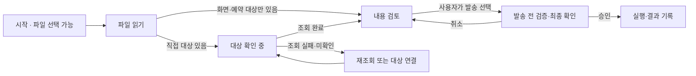

# KakaoSender·Spoiler 사용 흐름 검토 및 구현 계획

검토일은 2026-11-20이다. 기준 커밋은 `d186fc0`이다. 다음 구현자가 먼저 해결할 문제는 **사용자가 지금 실행할 수 있는 동작과 화면에서 누를 수 있는 동작이 다르다**는 점이다.

## 현재 동작과 근거

| 우선순위 | 사용자에게 생기는 일 | 확인한 경로 |
|---|---|---|
| 1 | 빈 화면에서도 발송을 누를 수 있다. CSV를 읽을 때 잠겼던 버튼이 파일 매칭 중 다시 열린다. 누르면 파일용 조회를 취소하고 발송용 조회를 시작한다. | 격리한 Tk에서 재현했다. `kakao_sender_gui.py`의 `set_document_loading`, `apply_loaded_document`, `start_sending`과 `kakao_gui_matching.py`의 `request_auto_chat_matches`를 따라갔다. |
| 1 | 직접 연결 점검 중 CSV 읽기가 끝나면 명단이 보인다. 이때 파일 매칭 요청은 로그 한 줄을 남기고 반환한다. 해당 분기에는 점검 종료 후 현재 파일을 다시 매칭하는 절차가 없다. | `HubLoadingMixin._document_read_blocked`, `HubChatMatchingMixin.request_auto_chat_matches`, `HubRunPanelsMixin.handle_diagnostic_result`. 코드 경로로 확인했다. |
| 1 | 화면 버튼과 작업 메뉴에 같은 기능이 있다. 버튼에 설정한 비활성이 메뉴로 전달되지 않는다. 예를 들어 직접 전송 모드는 메뉴도 같은 Tk 변수에 쓴다. | `build_menu_bar`, `on_direct_mode_changed`, `set_auto_match_send_wait`. 버튼 모양을 바꾸는 `refresh_primary_action_visual`도 실행 가능 여부를 결정하지 않는다. |
| 1 | Spoiler의 ‘수신 연결 새로고침’을 누르면 같은 계정의 작성 중인 답장도 사라질 수 있다. | `spoiler/src/MainWindow.cs`의 `ConnectOrRegister → RefreshAccountScope → ResetDisplayedInbox`가 `MainWindow.Rooms.cs`의 `ResetRoomUiState`를 호출한다. 이 함수는 방별 초안, 현재 입력, 검색, 선택을 지운다. 코드 경로로 확인했다. |
| 2 | 신규 연락처 한 명을 저장하려면 현재 명단에 이름을 넣고 ‘수동 매칭’을 열어야 한다. 이미 등록했지만 일시적으로 확인할 수 없는 대상도 다시 찾기 쉽다. | `open_manual_chat_mapping`은 기본 대상을 현재 행에서 얻는다. `show_manual_chat_mapping_dialog`는 미해결 대상만 받는다. 검증·저장·실패 시 원복은 `commit_manual_chat_mapping`에 이미 있다. |
| 2 | Spoiler는 첫 창을 그리기 전에 저장 대화를 읽는다. 같은 계정 재연결 때도 UI에서 저장소를 읽는다. | `MainWindow` 생성자와 `RefreshAccountScope`가 `LocoMessageSource.Inbox.cs::LoadStoredMessages`를 동기 호출한다. 실제 지연 시간은 별도 측정 대상이다. |
| 2 | Spoiler에서 다른 방으로 이동해도 이전 방의 답장이 처리 중이면 새 방 버튼도 ‘전송 중’으로 보인다. | `UpdateReplyAvailability`가 창 전체의 `_replyPending`을 문구에 사용한다. 완료 처리는 원래 방 키와 계정 세대를 확인한다. |
| 3 | 매칭 결과를 수정할 때 여러 세대의 위치 기반 튜플을 해석해야 한다. 작업 시작 자체가 실패하면 일부 버튼이 잠긴 채 남을 수 있다. | `handle_auto_chat_match_result`는 길이 6~12의 입력을 처리한다. 매칭·서버 진단·발송은 상태를 바꾸고 바로 스레드를 시작한다. 문서 읽기는 이미 시작 실패 복구 경로가 있다. |

**오류 원인의 범위.** 격리 시험에서는 시작 직후 첫 CSV 선택과 파싱에 성공했다. 파일 선택기를 테스트 대역으로 바꿨고, 실제 사용자 계정과 Windows 파일 대화상자 조합은 시험하지 않았다. 로컬 최신 매칭 기록에는 발송 전 누락 0건, 미검증 0건이 남아 있었다. 이 기록은 GUI 클릭 순서와 Tk 콜백 예외를 담지 않는다. 사용자가 겪은 오류 문구나 단일 원인을 이 자료로 확정할 수 없다.

## 1. KakaoSender에서 잘못된 시점의 조작 차단

파일을 고른 동작은 내용 검토까지 진행한다. 조회를 기다리는 동안 누른 발송을 나중에 자동 실행하지 않는다. 파일을 바꾸거나 닫으면 이전 파일의 결과는 버린다.

| 상태 | CSV 열기 | 발송 시작 | 화면에서 가능한 다음 행동 |
|---|---|---|---|
| 파일 선택 준비 전 | 잠금 | 잠금 | 준비 완료 후 즉시 열기 활성화 |
| 빈 화면 / 선택 범위 0행 | 가능 | 잠금 | 파일 열기 또는 행 추가·범위 변경 |
| 파일 읽기 | 교체 가능 | 잠금 | 마지막 파일만 적용. 읽기 취소 가능 |
| 직접 대상의 파일 매칭 중 | 교체 가능 | 잠금 | 미리보기·검색 가능. ‘대상 확인 중’ 표시 |
| 직접 연결 진단 중 | 가능 | 직접 경로 잠금 | 문서가 바뀌면 최신 파일 확인을 한 번 예약 |
| 조회 실패 / 대상 확인 필요 | 가능 | 미확인 직접 발송 잠금 | 기존 ID를 유지하고 ‘다시 조회’ 또는 ‘대상 연결’ 표시 |
| 발송 가능한 선택 범위 | 가능 | 가능 | 선택한 경로와 대상 수 확인 |
| 발송 전 확인 / 실행 / 결과 정리 | 잠금 | 잠금 | 허용된 시점에만 취소·중지. 기록 확정 후 해제 |

- **첫 변경.** 실제 입력에 필요한 준비 조건을 한 곳에 모은다. Tk와 독립된 함수가 작업별 허용 여부와 이유를 계산하게 한다. 기존 문서 세대, 발송 준비 토큰, 작업 감독 객체를 입력으로 쓴다. 같은 상태를 다시 저장하는 플래그 묶음은 만들지 않는다. 예약 카운터와 이전 기록 조회는 독립 작업으로 둔다. 시작 후 고정 시간 동안 전체 화면을 잠그지 않는다.
- **연결할 위치.** 툴바, 메뉴, 우클릭, 키보드, 드롭은 같은 판정을 쓴다. 명령 함수도 진입 직전에 다시 판정한다. 체크 메뉴는 변수 쓰기 전에 차단한다. CSV와 수동 편집, 복원된 명단, 일부 행만 발송, 예약 전용, 2차 전송의 기존 진입점을 포함한다. 기존 수동 연결과 사용자가 선택한 대체 경로는 계속 접근할 수 있게 한다.
- **완료 순서.** 파싱 결과를 채택할 때 현재 문서와 다음 매칭 상태를 함께 반영한다. 오래된 성공·실패·취소 결과는 새 문서의 버튼을 풀 수 없다. 진단이 끝나면 대기 중인 최신 파일·대상·모드가 일치할 때만 파일 매칭을 시작한다. 파일용 조회 완료는 발송 승인이 아니다. 기존 발송 직전 최신 검증과 최종 확인을 유지한다.
- **실패 처리.** 스레드 시작 실패, 취소, 종료, 결과 적용 실패를 현재 요청의 종료 경로로 보낸다. 재시도 가능한 작업만 다시 제시한다. 실행 기록에서 접수 여부가 불명인 행은 자동 재전송하지 않는다. 재현되지 않은 시작 오류를 위해 로컬에 단계, 명령, 문서 세대, 예외 종류, 소스 함수만 제한적으로 남긴다. 경로·이름·본문·인증값은 제외한다.
- **완료 기준.** 비활성 버튼·메뉴 호출은 팝업, 추가 조회, 발송을 모두 0회 발생시킨다. 유효한 첫 파일 선택은 1회로 끝난다. 파일 A→B 교체 후 A가 늦게 끝나도 B만 남는다. 진단 중 A→B를 읽으면 진단 종료 후 B만 확인한다. 서버 검증 통과 후 사용자가 명시적으로 승인해야 실행이 1회 시작된다.

## 2. Spoiler에서 재연결 시 작업 보존

1. `ConnectOrRegister`와 `RefreshAccountScope`에서 동일 계정 재연결과 실제 계정 변경을 구분한다. 확인된 동일 계정이면 현재 방, 방별 초안, 검색어, 스크롤을 보존한다. 계정이 바뀌거나 소유자를 확인할 수 없으면 이전 계정 내용을 즉시 숨긴다. 다른 계정에 초안을 복원하지 않는다.
2. 재연결 중에도 같은 방의 보관 내역을 읽을 수 있게 한다. 답장이 처리 중이면 원래 방에서만 ‘전송 중’을 표시한다. 다른 방에서는 초안을 작성할 수 있고, 전송이 잠긴 이유가 작성란 옆에 보이게 한다. 동시 발송 수는 그대로 유지한다. 결과 불명과 확정 실패를 구분한다. 재연결로 전송을 재시도하지 않는다.
3. 첫 화면 표시와 저장 기록 준비 시간을 각각 잰다. UI 스레드의 저장소 읽기가 지연의 주원인이면 기록 읽기를 백그라운드로 옮긴다. 계정 소유자와 세대를 결과에 묶는다. 동시에 수신한 이벤트는 기존 메시지 ID 병합을 거친다. 닫기·계정 변경 뒤 도착한 결과는 무시한다. `LoadStoredMessages`는 기존 소스 종료까지 할 수 있으므로 계정 변경과 수신 시작의 순서를 먼저 시험한다.
4. `spoiler/test/ResponsivenessTests.cs`에 동일 계정 재연결, 다른 계정 전환, 보관 목록에 아직 없는 선택 방, 새 초안 입력 뒤 옛 전송 완료를 추가한다. 가상 수신기로 읽음·타이핑·답장 호출 0회와 최신 초안 보존을 확인한다. 완료 영수증의 방 ID와 로그 ID 검사는 유지한다.

## 3. 신규 연락처와 저장 명단

‘연락처 등록’의 첫 범위는 **이미 존재하는 카카오 1:1 방을 발송 명단의 이름에 연결**하는 작업이다. 이 범위는 CSV 없이도 제공할 수 있다.

- 빈 화면에는 ‘연락처 등록’, 미해결 행에는 ‘이 대상 연결’을 제공한다. 두 진입점은 같은 검색·검증·저장 함수를 쓴다. 행에서 열면 이름을 미리 채운다. 기본 목록은 현재 필요한 대상만 보여준다.
- 저장 상태를 ‘등록됨’, ‘저장됨 · 현재 조회 대기’, ‘동명이인 · 선택 필요’, ‘연결할 방 없음’으로 구분한다. 저장된 이름과 서버 표시명을 나란히 보여준다. 같은 이름의 후보는 구분 가능한 방 정보와 ID 끝자리로 구별한다. 관련 없는 명단 전체를 다시 등록하게 하지 않는다.
- `kakao_gui_matching.py`의 후보 검증과 `kakao_mapping_policy.py`의 소유권 규칙을 재사용한다. 확정 전에 최신 1:1 방과 상대 ID를 확인한다. 다른 CSV 대상이 쓰거나 보호된 ID는 자동 이전하지 않는다. 저장에 실패하면 화면도 원복한다. 작업을 완료하면 문제 행과 집계만 갱신한다.
- Spoiler는 계정과 방 ID가 일치하는 수신 기록에만 이름을 적용한다. 두 앱이 같은 방을 같은 이름으로 표시하는지 합성 예제로 대조한다. 이름 자료를 공유해야 한다면 계정 식별 가능 여부부터 확인한다. 계정 소속을 증명할 수 없는 Sender 설정을 Spoiler가 일괄로 읽는 방식은 채택하지 않는다. 단톡방의 방 제목은 개인 연락처에 합치지 않는다.
- 검증 사례는 신규 방, 빈 1:1 방, 같은 이름의 서로 다른 상대, 보호자·학생 별도 방, 저장 후 재시작, 부분 조회, 저장 중 충돌이다. **카카오 친구 추가나 새 서버 대화방 생성**은 별도의 제품 결정이다. 기존 방 연결을 구현하는 데 필요하지 않다.

## 4. 디자인과 코드 구조

- KakaoSender의 상단 한 줄에 현재 단계와 다음 행동을 붙인다. 예를 들어 ‘대상 30명 확인 중’, ‘2명 연결 필요 · 대상 보기’를 표시한다. 연결 실패 후에는 로그를 열지 않아도 재조회할 수 있어야 한다. 상태를 색과 텍스트로 함께 표현한다. 주 작업 버튼의 위치·폭과 키보드 포커스를 유지한다.
- Spoiler는 방 목록·대화·작성란 구성을 유지한다. 재연결 상태는 연결 제어 옆에, 특정 방 답장 결과는 해당 작성란 옆에 둔다. 보관 개수와 카카오의 실제 안 읽은 개수를 구분한다. 양쪽 모두 기존 Tk/ttk·WPF 테마와 한국어 줄바꿈 규칙을 사용한다.
- 매칭 결과 생산자부터 이름 있는 결과 객체를 쓰도록 바꾼다. 기존 길이별 튜플은 큐 입구에서 한 번만 변환한다. 실제 호출자와 호환 테스트를 확인한 뒤 호환 경로를 줄인다. 준비 상태 판단, 서버 조회, 최종 영수증 판정은 각각 한 곳에서 소유한다. 예약 저널·첨부 스냅숏·전송 서비스의 내부 재작성은 이번 개선의 선행 조건이 아니다.
- 사용자가 따로 보고하지 않은 항목도 측정한다. Tk 시작 시 `RunJournal()` 초기화 시간, 매칭 결과의 동기 진단 파일 쓰기, Spoiler 창의 첫 표시와 기록 읽기 시간을 구분한다. 지연이 측정된 경로만 옮긴다. 진단 쓰기를 옮길 때는 최신 결과와 최근 문제의 저장 순서를 보장한다.

## 검증과 커밋 순서

이번에 실행한 검사는 다음과 같다.

| 검사 | 결과와 한계 |
|---|---|
| 격리된 Tk 명령 경로 | 빈 명단에서 발송 활성 → 파싱 중 비활성 → 파일 매칭 중 활성. 이때 발송 진입 후 기존 취소 신호가 설정되고 요청 수가 1에서 2로 증가했다. 가상 CSV를 사용했고 두 조회 스레드는 시작 직전에 멈췄다. 서버 지연은 측정하지 않았다. |
| Python 선택 검사 | `test_kakao_gui_responsive_loading.py`, `test_kakao_gui_send_preparation_cancel.py`, `test_kakao_gui_responsive_matching.py`, `test_kakao_new_chat_recovery.py`에서 40개 통과, 3개 실패. 실패 3개는 취소 테스트의 `__new__` 대역에 `direct_mappings`가 없어 Tk 속성 조회가 재귀한 결과다. 실제 생성자는 이 필드를 초기화한다. 별도 프로세스에서 대역에 빈 매칭·표시명 사전을 넣자 해당 클래스의 7개 검사가 모두 통과했다. |
| Spoiler Node 선택 검사 | `room-names`, `empty-room-names`, `reply-lifecycle`의 합성 테스트 40개 통과. WPF 재연결 화면의 실사용 성능은 이 검사에 포함되지 않는다. |

다음 구현은 아래 단위마다 독립적으로 검증하고 커밋한다.

1. **기준 복구.** 취소 테스트 대역에 실제 생성자의 매칭 상태를 넣고, 기존 취소·늦은 콜백 검증을 유지한다. 시작 직후 클릭, 진단과 파일 교체, 매칭 중 메뉴 발송을 재현하는 실패 테스트를 추가한다. 운영 코드에 테스트 전용 우회 처리를 넣지 않는다.
2. **KakaoSender 상태와 입력.** 1절의 작업별 판정을 연결한다. 읽기·매칭·발송 준비의 완료 순서를 바꾼 합성 검사를 돌린다. 30행·100행에서 버튼과 메뉴를 반복 호출해 발송 서비스 호출 수를 확인한다. 파일 읽기 실패 후 기존 미리보기의 출처를 명확히 표시한다.
3. **Spoiler 재연결과 초안.** 2절을 구현하고 WPF 합성 화면으로 검사한다. 연결이 끊긴 상태의 검색, 방 전환, 새 메시지와 늦은 영수증을 포함한다.
4. **신규 연락처.** CSV 없이 등록 → 재시작 → 해당 이름을 담은 CSV 열기를 한 시나리오로 검사한다. 저장 실패·취소 시 두 앱의 기존 이름이 보존돼야 한다. 기존 수동 등록과 복구 스크립트의 검증 결과도 비교한다.
5. **화면·성능 마감.** Tk 1024×720과 최대화, WPF 760×560과 최대화, Windows 배율 100%·150%를 확인한다. 긴 한글 이름, 긴 파일 경로, 키보드 조작을 포함한다. 합성 자료와 장비를 고정하고 반복 측정해 첫 창 표시, 첫 입력 반응, 파일 선택부터 검토 가능까지의 중앙값과 95백분위수를 전후 비교한다. 사용자가 해결해야 하는 팝업 수, 입력 횟수, 조회 횟수도 기록한다. 결과 전에는 속도 향상 수치를 약속하지 않는다.
6. **배포 판정.** `python -m pytest -q tests`, `node --test tests/*.mjs`, `spoiler/build.ps1`의 WPF·브리지 검사를 수행한다. 결과 불명 재전송 0회, 이전 문서로 실행 0회, 계정 간 초안 노출 0건을 확인한다. 기존 CSV·설정·저널을 복사한 합성 호환성 검사 후 소스와 문서만 공개 원격에 올린다. 설치된 Spoiler 교체는 빌드 검증과 별도 단계로 다룬다.
