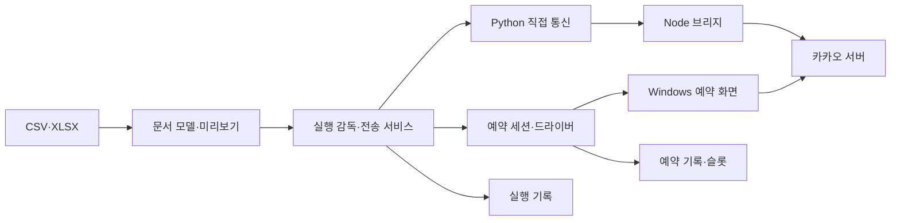
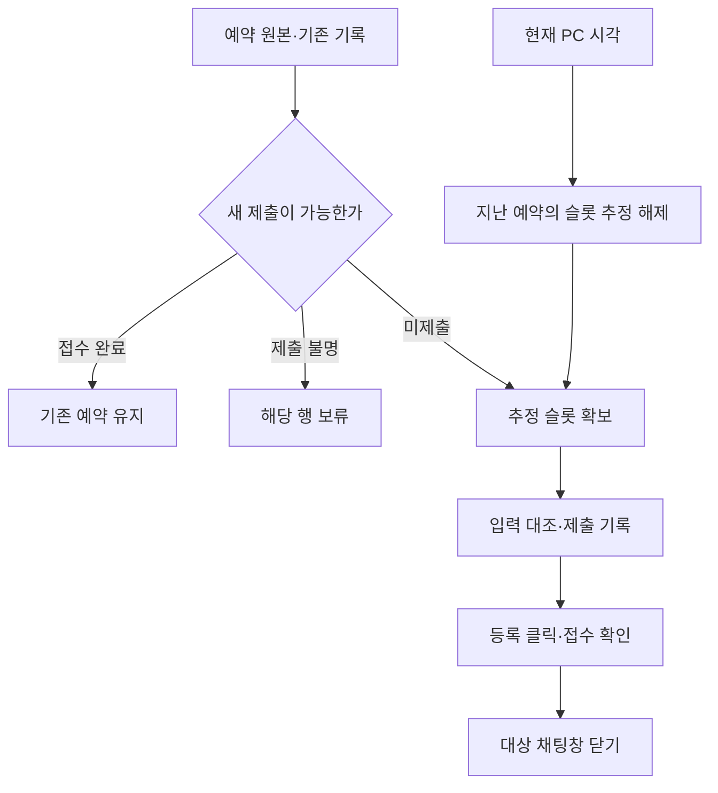
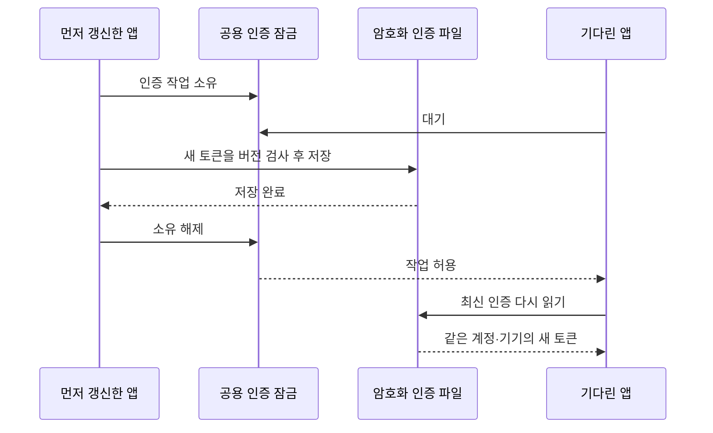

# 프로그램 구조의 변화

구조 변경의 목적은 파일 수를 늘리는 것이 아니었다. **외부 작업을 한 곳에서 관리하고, 기록한 사실과 화면 표시를 같게 만드는 것**이었다. 사용자 입력, 통신, 저장, 화면 조작과 렌더링의 책임을 점차 나눴다.

이 단계는 세션과 검증 자료에서 재구성했다. 초기 일부 작업은 시각이 없으므로 날짜를 확정하지 않았다. 공개 Git의 연속 커밋 목록으로 읽으면 안 된다.

## 변화 순서

| 단계·시기 | 이전 상태와 변경 이유 | 구조 변경 |
|---|---|---|
| 초기 KakaoSender · 일부 시각 미기록 | CSV·창 검색·붙여넣기·예약이 큰 모듈에 모임. 부분 제목 일치는 오발송 위험 | 제목 비교를 엄격하게 하고 실행 옵션을 고정. 작업 스레드의 Tk 접근을 큐로 옮김 |
| 초기 배포 중단 · 시각 미기록 | 사용자가 당분간 배포하지 않기로 선택 | 설치·패키징·Git 구성을 제거하고 Python 직접 실행으로 정리. 이후 삭제 사고와 별개 |
| 2026-07-31 예약·재시도 UX | 시간 입력과 실패 행 재처리가 불편 | 공통·행별 예약 선택기, 현재 시각 이후 5분 슬롯, 실패 행 재시도. 결과는 당시 마지막 실행 중심 |
| 2026-08-28 Spoiler 시작 | 알림·PC UI 수집이 오탐을 만들고 요구와 다름 | WPF 화면은 유지하고 태블릿 인증·Node LOCO 수신을 제품 경로로 선택 |
| 2026-08-28~29 Spoiler 복구 | 실시간 수신만으로 종료 중 공백을 보완할 수 없음 | 방별 복구 위치, 중복 ID, 이름 캐시, 읽기 전용 페이지 조회, 트레이 실행 |
| 2026-08-29 직접 전송 도입 | KakaoSender가 마우스·키보드 발송에 의존 | Spoiler의 태블릿 인증 기반을 활용한 Python↔Node 브리지와 직접 텍스트 전송. 예약은 화면 경로 유지 |
| 2026-08-30~09-04 매칭·실행 경계 | 파일 로드가 PC를 조작하고, 부분 목록이 매칭을 흔듦. 취소·정리·완료 이벤트가 분산 | 저장 매칭 보호, PC 찾기 분리, 실행 ID·한 번의 최종 결과·취소 재검사·자원 정리. 명확한 직접 실패만 수동 2차 화면 전송 |
| 2026-09-05 Hub 2.4 | 입력 실패·발송 후 정리 실패·다중 앱 입력·중단 복구가 약함 | 문서·서비스·실행·매칭 정책 분리. 공용 PC 잠금, SQLite 실행 기록, 방식·진행 표시. 로컬 Git과 고정 의존성 도입 |
| 2026-09-05 Spoiler 저장 구조 | 중복 ID와 본문 저장의 순서, 계정 전환, 브리지 종료가 어긋남 | 계정별 InboxStore에서 본문·중복 ID·복구 위치를 함께 확정. 저장 후 화면 전달, 종료·재연결 감시 |
| 2026-09-07~08 대량 직접 전송 | 빈 ACK 성공 표시와 묶음 경계의 연결 단절 | Node·Python·서비스 접수 검증, 30행 후 2초 대기, 전송 전 연결 실패만 제한된 복구. 파일 직접 업로드 추가 |
| 2026-09-20~21 연결·목록 | 인증 거절과 일반 오류를 섞고 전체 목록 실패가 모든 작업을 막음 | 명확한 인증 오류에만 재인증. 전체 조회 실패 시 저장 ID 개별 검증 |
| 2026-09-28 Hub 2.5 | 사람의 화면 확인 왕복이 느리고 기존 GUI와 새 코드가 분리됨 | 관측 규칙을 NativeScheduleSession과 드라이버로 구현. GUI·CLI 공용 저널과 슬롯 관리. 54건 실제 예약 저장 대조 |
| 2026-09-30 공용 기반 정리 | 인증 동시 저장, 메시지별 전체 저장, 대상별 첨부 준비, 큰 파일과 누락된 빌드 입력 | 공용 저장 잠금·버전 검사와 서버 인증 조율, 수신 묶음 저장, 첨부 복사, 책임 분리, 고정 런타임 검증 |
| 2026-09-30~10-01 대화방 UI | 작성자별 옛 그룹, 내 메시지 공백, 늦은 방 이름 | 실제 방 ID로 분류, 내·상대 타임라인, 독립 페이지 진행점, 메타데이터 갱신, 직접 답장 |
| 2026-10-02~03 예약 상태 정리 | 목록 OCR 의존, 클릭 전·후 실패 혼동, 늦은 알림, 남은 창·초안 | 로컬 기록·시계 카운터, 제출 경계 분리, 접수 관측, 대상 채팅창 닫기, 이전 초안 복구 |
| 2026-10-06 새 방·보관 | 처음 발견한 방과 오전 메시지가 보관 대상에서 빠짐 | 동기화 캐시 기반 방 발견, 미완료 복구 범위 저장, 전체 1,000개·7일 한도 |
| 2026-10-07~09 화면·한국어 | 동기 I/O와 전체 재렌더, 불균일한 버튼 상태, 음절 줄바꿈 | 기존 Tkinter·WPF의 토큰·상태 통일, 비동기 I/O·부분 갱신·재사용, 표시와 원문 분리 |
| 2026-10-10 OCR·공개 저장소 | 반복 OCR 프로세스 준비와 별도 프로젝트 관리 | 묶음 전용 OCR 작업자, 정확한 이미지 캐시, 루트 Sender와 spoiler 폴더의 공개 통합 저장소 |

8월 30일부터 조사한 서버 직접 예약은 제품 전송 경로에 들어오지 않았다. 요청·응답·조회 계약의 재현 성공을 확인하지 못했다. 실제 예약 자동화는 9월 28일 화면 경로로 완성하고 후속 오류를 보완했다.

## KakaoSender의 현재 실행 구조

실행 서비스가 행의 경로를 정한다. 직접 전송은 통신 브리지로 간다. 예약은 카카오톡 화면으로 간다. 각 결과는 기록에 남는다. 직접 전송 OFF의 일반 화면 발송과 명시적 2차 화면 전송도 PC 잠금을 사용한다.

| 책임 | 현재 파일 | 분리해서 얻은 기준 |
|---|---|---|
| 파일·편집 모델 | [kakao_document.py](../../kakao_document.py), [kakao_gui_loading.py](../../kakao_gui_loading.py) | 검증이 끝난 새 문서만 반영. 읽기 실패가 기존 문서를 부분 변경하지 않음 |
| 매칭 | [kakao_mapping_policy.py](../../kakao_mapping_policy.py), [kakao_chat_catalog.py](../../kakao_chat_catalog.py), [kakao_gui_matching.py](../../kakao_gui_matching.py) | ID 검증과 후보 표시 분리. GUI·CLI 보호 규칙 공유 |
| 실행 수명 | [kakao_send_run.py](../../kakao_send_run.py), [kakao_send_service.py](../../kakao_send_service.py) | 실행 ID, 취소, 정리와 한 번의 최종 결과를 한 소유자가 관리 |
| 직접 통신 | [kakao_direct.py](../../kakao_direct.py), [bridge/](../../bridge) | JSON 계약과 전송 전 실패·전송 후 불명 구분 |
| PC 입력 | [kakao_pc_lease.py](../../kakao_pc_lease.py), [kakao_sender.py](../../kakao_sender.py), [kakao_gui_screen.py](../../kakao_gui_screen.py) | 프로세스 직렬화, 입력 직전 대상·포커스 검사, 중단 표시 |
| 즉시 실행 복구 | [kakao_run_journal.py](../../kakao_run_journal.py) | 시도·결과 저장. 원본 행의 후속 실행 인계를 한 번만 허용 |
| 예약 | [kakao_schedule_session.py](../../kakao_schedule_session.py), [kakao_native_schedule.py](../../kakao_native_schedule.py) | GUI·CLI가 같은 준비·제출·접수·정리 규칙 사용 |
| 예약 중복·수량 | [kakao_schedule_journal.py](../../kakao_schedule_journal.py), [kakao_schedule_capacity.py](../../kakao_schedule_capacity.py) | 재등록 가능 여부와 시간에 따른 슬롯 추정 분리 |
| 첨부 준비 | [kakao_attachment_run.py](../../kakao_attachment_run.py) | 실행 시작 내용 고정. 모든 대상과 재연결이 같은 복사본 사용 |
| 화면 응답 | [kakao_gui_feedback.py](../../kakao_gui_feedback.py), [kakao_gui_panels.py](../../kakao_gui_panels.py), [kakao_gui_exports.py](../../kakao_gui_exports.py) | GUI 스레드 반영. 늦은 작업이 현재 화면을 덮지 않음 |
| OCR | [kakao_windows_ocr.py](../../kakao_windows_ocr.py), [kakao_ocr_worker.py](../../kakao_ocr_worker.py) | 기존 API 유지. 묶음 안에서 엔진·정확한 결과만 재사용 |

초기 GUI는 검토 당시 6,295행이었다. 9월 30일 분리 직전 5,762행에서 3,423행으로 줄었다. 이동한 함수·메서드 49개의 AST 본문 일치도 확인했다. 이는 당시 분리의 근거이며 현재 길이가 계속 3,423행이라는 뜻은 아니다. [구조 개선 보고서](../STRUCTURE_IMPROVEMENTS_2026-09-30.md)

## 예약 슬롯과 중복 방지는 다른 규칙이다

시각이 지나면 여유 슬롯 추정은 늘어난다. 그 행이 다시 제출 가능한 것은 아니다. 제출 이력은 남는다. 접수 후 창 정리도 성공 이력을 취소하는 작업이 아니다.

`acknowledged`는 접수 알림 확인이다. `verified`는 저장 상세의 대상·시각·전체 본문 대조다. 둘 다 미래의 실제 발송·수신 완료 상태는 아니다.

## Spoiler의 현재 수신·답장 구조

수신은 저장을 먼저 확정한 뒤 화면에 전달한다. 답장은 별도 사용자 동작이다. 성공한 답장도 저장한 뒤 화면과 초안에 반영한다. 수신·검색·방 선택 경로에 읽음 처리 명령을 연결하지 않는다.

| 책임 | 현재 파일 | 변경의 의미 |
|---|---|---|
| 연결·프로세스 | [LocoMessageSource.cs](../../spoiler/src/LocoMessageSource.cs), [LocoBridgeLauncher.cs](../../spoiler/src/LocoBridgeLauncher.cs) | 연결 감시와 프로세스 수명을 화면에서 분리 |
| 인증 | [LocoMessageSource.Authentication.cs](../../spoiler/src/LocoMessageSource.Authentication.cs), [CredentialVault.cs](../../spoiler/src/CredentialVault.cs) | 등록·갱신·저장 ACK와 공용 잠금 |
| 수신 확정 | [LocoMessageSource.Inbox.cs](../../spoiler/src/LocoMessageSource.Inbox.cs), [InboxStore.cs](../../spoiler/src/InboxStore.cs) | 본문·중복 ID·복구 위치·이름을 계정별로 함께 저장 |
| 방 발견·내역 보완 | [room-discovery.mjs](../../spoiler/bridge/src/room-discovery.mjs), [conversation-sync.mjs](../../spoiler/bridge/src/conversation-sync.mjs) | 새 방 발견과 페이지 진행을 실시간 최대 로그와 분리 |
| 방 제목 | [room-names.mjs](../../spoiler/bridge/src/room-names.mjs), [ChatRoomGrouping.cs](../../spoiler/src/ChatRoomGrouping.cs) | 이름과 방 정체성 분리. 제목이 같아도 방 ID가 다르면 합치지 않음 |
| 화면 | [MainWindow.Rooms.cs](../../spoiler/src/MainWindow.Rooms.cs), [MainWindow.RoomResponsiveness.cs](../../spoiler/src/MainWindow.RoomResponsiveness.cs) | 방별 초안·선택·스크롤 유지, 기존 말풍선 재사용 |
| 답장 | [LocoMessageSource.Replies.cs](../../spoiler/src/LocoMessageSource.Replies.cs), [replies.mjs](../../spoiler/bridge/src/replies.mjs) | 명시적 단건 송신, ACK·저장 확인, 자동 재전송 금지 |
| 계약·배포 | [LocoBridgeProtocol.cs](../../spoiler/src/LocoBridgeProtocol.cs), [EmbeddedRuntime.cs](../../spoiler/src/EmbeddedRuntime.cs), [build.ps1](../../spoiler/build.ps1) | 한 줄 JSON 계약과 내장 런타임 검증 분리 |

9월 30일 수신 주 파일은 당시 1,801행에서 745행으로 줄었다. 사용하지 않던 체크포인트 저장 모듈은 제거했지만 커서와 필요한 검사는 유지했다. 이름만 같다는 이유로 옛 기록을 새 방에 옮기는 동작은 추가하지 않았다.

## 두 앱이 공유하는 인증

통신 세션은 앱마다 별도다. 인증 파일과 조율 규칙은 공유한다. 장치마다 목적이 다르다.

| 장치 | 막는 문제 |
|---|---|
| 로컬 저장 잠금·버전 비교 | 늦게 도착한 저장이 새 토큰을 덮어쓰는 문제 |
| 서버 인증 작업 잠금 | 두 앱이 동시에 OAuth 갱신·태블릿 등록을 시작하는 문제 |
| 저장 ACK | 저장 실패한 새 토큰을 정상 세션처럼 사용하는 문제 |
| 계정·기기 검사 | 다른 계정의 갱신 결과나 기록을 현재 앱에 반영하는 문제 |

기다린 앱은 오래된 토큰으로 곧바로 갱신하지 않는다. Python과 C#이 같은 계약을 사용한다. [인증 조율 검사](../../tests/test_kakao_auth_lease.py), [저장 경쟁 검사](../../tests/test_credential_vault_concurrency.py)에서 이 순서를 확인한다.

## 빌드 복구와 통합 저장소

Spoiler는 Node·bridge를 담은 단일 Windows EXE로 빌드한다. 고정 버전과 파일 크기·SHA-256을 검증한다. KakaoSender의 인증 실행환경도 Spoiler가 공개한 검증 manifest를 확인한다. 수정 시각이 새롭다는 이유만으로 임의 캐시를 고르지 않는다.

공개 저장소에서는 KakaoSender를 루트에, Spoiler를 `spoiler/`에 뒀다. 기존 실행 경로와 사용자 데이터 형식은 유지했다. 통합 저장소가 두 앱을 하나의 프로세스로 합친 것은 아니다. 인증·대화·로그·실제 CSV·빌드 파일도 소스와 함께 복사하지 않았다.

앱 필수 소스와 빌드 입력 복구는 확인했다. 삭제 사고의 모든 문서와 옛 Git 이력 복구를 뜻하지 않는다. 공개 이력의 시작점과 설치 순서는 [통합 프로젝트 안내](../MONOREPO.md)에 있다.

[목표](PROJECT_GOALS.md) · [오류와 해결](INCIDENTS_AND_FIXES.md) · [검증 근거](EVIDENCE_AND_LIMITS.md)
