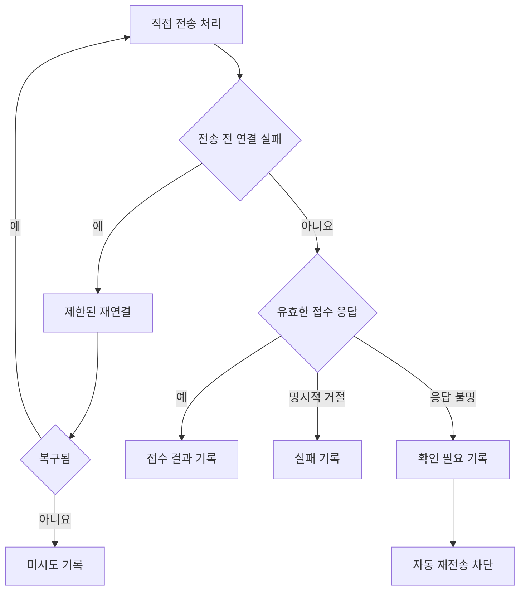

# 주요 오류와 해결 과정

오류를 많이 고친 것보다 중요한 변화는 **확인한 사실에 맞춰 상태를 기록하는 것**이다. 창이 닫혔다고 예약 성공으로 보지 않는다. 응답이 비었다고 미발송으로 보지 않는다. 목록에 없다고 확인한 방 ID를 지우지 않는다.

이 문서는 사용자 신고와 당시 조사 결과를 함께 정리한다. ‘원인’은 확인된 코드 결함을 뜻한다. 서버의 내부 사유를 복원하지 못한 경우에는 이를 따로 표시한다. 사례의 개인 이름과 실제 방 ID는 제외했다.

## I01. Spoiler가 대화 대신 광고·입력창을 수집함 · 2026-08-28

초기 알림 수집 경로는 카카오톡 자식 UI를 메시지 알림으로 오인했다. 사용자가 보낸 실제 대화는 보이지 않고 입력창·광고 항목이 표시됐다. 오탐 필터만 고치는 것으로는 알림을 꺼도 서버 메시지를 읽고 싶다는 목적을 충족하지 못했다.

제품 수신 경로를 태블릿 보조기기 인증과 LOCO 메시지 이벤트로 바꿨다. 현재 일반 실행은 `LocoMessageSource`를 사용한다. PC 알림 팝업이나 화면 OCR은 대화 본문의 수신원이 아니다. 저장소에 남은 알림 관련 파일의 존재와 현재 실행 경로를 구분해야 한다.

근거: [현재 화면의 수신원 선택](../../spoiler/src/MainWindow.cs), [Node 수신 브리지](../../spoiler/bridge/src/bridge.mjs), [Spoiler 안내](../../spoiler/README.md).

## I02. CSV나 첨부만 넣었는데 마우스가 움직임 · 2026-08-30 이후

파일 불러오기가 자동 매칭을 시작했고, 매칭이 PC 대화창 조회로 넘어가면서 입력 장치를 사용했다. 초기 직접 전송은 텍스트만 지원했으며 첨부도 화면 방식으로 넘어갔다. 사용자가 생각한 ‘준비’와 실제 외부 조작이 섞여 있었다.

파일 등록과 자동 매칭에서 PC 입력 경로를 분리했다. 화면 조회는 명시적인 PC 찾기 작업으로 남겼다. 이후 파일 업로드와 첨부 메시지 직접 전송을 구현했다. 현재 예약 없는 텍스트·파일의 직접 전송은 화면을 사용하지 않는다. 예약과 화면 전송은 사용 표시를 갖는다.

근거: [매칭 경로](../../kakao_gui_matching.py), [전송 경로 선택](../../kakao_send_service.py), [파일 드롭 검사](../../tests/test_kakao_file_drop.py), [직접 전송 GUI 검사](../../tests/test_kakao_gui_direct.py).

## I03. 저장한 매칭이 사라지거나 전체 목록 조회가 실패함 · 2026-08-31~10-01

서버 목록은 완전한 데이터베이스 사본이 아니었다. 일부 방이 빠진 목록으로 갱신하면서 이전 매칭을 잃거나, 새 ID를 같은 이름에 덮어쓰는 위험이 있었다. 수동 후보 목록도 태블릿의 제한된 목록에만 의존하면 원하는 방을 찾기 어려웠다.

확인된 매칭은 불완전한 조회의 누락만으로 삭제하지 않는다. ID 충돌, 중복 이름, 계정·기기 변경 같은 근거를 별도로 검증한다. GUI와 CLI가 보호 라벨 정책을 공유하고, 설정 저장 경쟁도 조율한다. 같은 이름이라는 이유만으로 다른 방을 자동 연결하지 않는다.

9월 21일에는 Spoiler가 정상인데 Hub가 `get_chats_failed`를 로그인 문제로 안내했다. 조사 결과는 전체 `LCHATLIST` 조회 실패였다. 저장 ID를 `CHATINFO`로 각각 검증하는 대체 경로를 적용했다. 당시 저장 매칭 180건의 개별 조회를 실제 세션에서 확인했으며 메시지는 보내지 않았다.

10월 1일에는 CSV 등록 후 약 6초 지연을 줄이기 위해, 모든 대상의 저장 매칭이 유효할 때 이번 파일의 ID만 조회하도록 바꿨다. 누락·충돌이 있으면 전체 조회로 전환한다. 실제 6초의 개선율은 당시 다시 측정하지 않았다.

근거: [매칭 정책](../../kakao_mapping_policy.py), [카탈로그](../../kakao_chat_catalog.py), [매칭 처리](../../kakao_gui_matching.py), [매칭 조회 검사](../../tests/test_kakao_gui_matching_latency.py), [CLI 매칭 검사](../../tests/test_refresh_student_chat_mappings.py).

## I04. 85명 중 일부만 전송됐는데 전부 초록색 · 2026-09-07

사용자 신고는 ‘실패 0건인데 일부만 전송’이었다. 저장 CSV 85행은 모두 `direct_sent`였다. 처음 30행에는 서버 메시지 ID가 있었지만 뒤의 55행에는 없었다.

확인된 결함은 ACK 검증 부족이었다. 패킷의 성공 코드만 확인하고 빈 메시지 ID와 0 시각을 허용했다. Node, Python, 서비스가 불완전한 성공을 그대로 전달했다. 당시 원본에는 충분한 응답이 없어 서버가 왜 이런 결과를 냈는지는 확정하지 못했다. 속도 제한을 확정 원인으로 쓰지 않는다.

응답 명령, 패킷·본문 상태, 메시지 ID, 시각과 대상 정보를 검증하도록 수정했다. 불완전한 응답은 `unknown`으로 남기고 후속 발송을 멈춘다. 성공 색상도 새 실행에서 초기화한다. 기본 속도는 사용자 요구대로 30대상 행 후 2초 대기다.

가상 재현에서는 정상 ACK 30개 다음의 빈 ACK에서 성공 30·확인 필요 1·미시도 54로 나뉘었다. 이후 별도 허가된 후속 작업에서는 기존 성공자를 제외하고 52건의 서버 ID와 대화 기록을 확인했다. 이는 상대방의 수신·읽음 완료 증명은 아니다.

근거: [단건 ACK 검사](../../bridge/kakao_direct_send_once.mjs), [Python 응답 검사](../../kakao_direct.py), [서비스 결과 처리](../../kakao_send_service.py), [ACK 회귀 검사](../../tests/test_kakao_direct_send_once.mjs), [텍스트 접수 검사](../../tests/test_kakao_direct_text_receipt.py).

## I05. 30건 뒤 2초 기다리고 그대로 멈춤 · 2026-09-08

별도 80행 실행에서 처음 30행은 접수 ID가 있었다. 31번째는 WRITE 전 세션 확보 오류였고 나머지 49행은 미시도였다. 2초 대기는 동작했지만 연결을 복구할 경로가 없었다. 하위 오류를 버려 당시 연결 실패의 세부 원인도 남지 않았다.

전송을 시작하지 않았다는 증거가 있는 오류를 `DirectSendNotStartedError`로 나눴다. 일시 연결 오류이면 브리지를 교체하고 현재 대상부터 최대 두 번 복구한다. WRITE 후 결과 불명이나 부분 첨부 성공에는 이 규칙을 적용하지 않는다. 복구가 끝내 실패하면 현재 행과 후속 행을 미시도로 남긴다.

31번째·61번째 연결 실패를 넣은 80행 가상 실행에서 중복 WRITE 없이 완료했다. 이 시험은 실 서버의 모든 단절 상황을 보장하지 않는다.

재연결과 재전송의 경계는 실제 WRITE가 시작됐는지다. 근거: [서비스 복구](../../kakao_send_service.py), [전송 전 복구 검사](../../tests/test_kakao_direct_prewrite_recovery.py), [전체 전송 수명주기](../../kakao_send_run.py).

## I06. 예약 검색·버튼·시간 메뉴가 창마다 어긋남 · 초기 단계~2026-10-03

초기 예약은 절대 검색 좌표와 창 내부의 후보 위치에 의존했다. 모서리에서는 팝업 방향과 표시 행 수가 바뀌었다. 검색창에 포커스가 없을 때 `Ctrl+A`가 다른 카카오톡 기능을 열기도 했다. 작은 시간 메뉴에서는 잘린 숫자 일부를 목표 숫자로 읽는 오류가 있었다.

새 드라이버는 현재 HWND·PID·창 위치·포커스와 검색 Edit를 확인한다. 예약창의 실제 화면에서 대상, 전체 본문, 날짜, 오전·오후, 시·분을 읽고 입력 후 다시 비교한다. 시간 메뉴는 읽은 값의 순서와 실제 문자 행의 경계를 사용한다. 잘린 행은 선택하지 않는다.

9월 28일에는 작은 창, 위치 변경, 최대화, 최소화 복원, 다음 달 선택을 실제 입력 시험으로 확인했다. 추가 입력 시험에서는 등록 버튼을 누르지 않았다. 10월 3일 보강에서는 저장된 메뉴 선택 56회를 대조했다. 다른 카카오톡 버전이나 모든 DPI 조합의 성공을 입증한 것은 아니다.

근거: [네이티브 드라이버](../../kakao_native_schedule.py), [시간 메뉴 OCR](../../kakao_dropdown_ocr.py), [입력값 대조](../../kakao_schedule_readback.py), [메뉴 검사](../../tests/test_kakao_dropdown_ocr.py), [현재 예약 안내](../NATIVE_RESERVATIONS.md).

## I07. 등록 여부가 불명확한데 다시 누를 위험 · 2026-09-28~10-03

처음에는 예약창 닫힘을 성공으로 취급했다. 이후에는 반대로 버튼을 누르기 전 가려진 화면에서 실패했는데 제출 결과 불명으로 기록해 재개를 막는 오류도 있었다. 같은 ‘실패’로 묶으면 중복 등록과 불필요한 보류가 함께 생긴다.

등록 버튼을 누르기 전에 제출 기록을 먼저 저장한다. 클릭 전 창·겹침 검사 실패는 `rejected_before_submit`으로 남긴다. 실제 클릭을 시도한 뒤 응답을 잃으면 `submitting` 또는 `unknown`으로 막는다. 이미 접수된 행은 ‘기존 예약 유지’로 재사용한다.

이전 실행의 불명 행은 그 행만 보류하고 다른 미등록 행을 진행할 수 있다. 현재 실행에서 새 제출이 불명확해지면 후속 입력을 중단한다. 사용자가 실제 예약을 취소했다고 확인한 경우에만 별도 도구로 취소 상태를 반영한다. 저널을 지우거나 시간만 지났다는 이유로 재등록 가능 상태로 바꾸지 않는다.

근거: [예약 저널](../../kakao_schedule_journal.py), [공용 세션](../../kakao_schedule_session.py), [클릭 전 실패 검사](../../tests/test_kakao_schedule_preclick_recovery.py), [취소 반영 검사](../../tests/test_kakao_schedule_cancellations.py).

## I08. 접수 알림을 놓치고 초안·채팅창이 다음 행을 방해함 · 2026-10-02~03

예약창이 닫힌 직후 한 번만 관측하면 늦은 접수 알림을 놓쳤다. 반투명 알림에는 배경 글자가 섞였다. 큰 채팅창의 비율을 기준으로 알림 크기를 판단하면 작은 실제 알림도 버렸다. 앞선 채팅창이 남으면 다음 창을 여러 후보 중에서 고를 수 없었다.

창 닫힘은 최대 10초, 새 접수 알림은 최대 5초까지 관측한다. 확인되면 바로 진행하고 등록 버튼은 다시 누르지 않는다. 실제 알림 바탕과 글자 픽셀을 분리해 판독한다. 접수 후에는 **그 행의 채팅창만 Esc로 닫고 닫힘을 확인**한다. 정리 실패가 이미 접수된 결과를 지우지는 않는다.

미등록 양식을 닫다가 남은 ‘작성을 취소하시겠습니까?’ 창도 별도 상태로 처리한다. 소유자와 문구를 확인해 입력 화면을 복구한 뒤 CSV의 대상·전체 본문과 비교한다. 다른 초안을 임의로 버리지 않는다. 초안 정리에서는 아직 설정하지 않은 날짜·시간을 요구하지 않는다.

10월 3일의 45행 작업은 기존 접수 12건을 유지하고 새 33건을 접수했다. 새 33건은 각각 한 번 제출했고 접수 후 Esc 닫힘도 33회 확인했다. 최종 상태는 `acknowledged` 43건과 `verified` 2건이었다. **45건 모두 저장 상세까지 검증했다는 뜻은 아니다.**

근거: [드라이버](../../kakao_native_schedule.py), [접수 알림 검사](../../tests/test_kakao_native_schedule_toast.py), [접수 후 창 닫기 검사](../../tests/test_kakao_registered_chat_close.py), [취소창 검사](../../tests/test_kakao_schedule_dialog.py), [검증 범위](EVIDENCE_AND_LIMITS.md).

## I09. 실제 예약 목록이 0인데 수량 OCR 실패로 중단 · 2026-10-02

초기 100슬롯 검사는 카카오톡 예약 목록의 대기 수를 읽었다. 빈 목록이나 다른 탭을 잘못 읽으면 새 예약이 없어도 사전 검사가 막혔다. 사용자는 목록 조회를 없애고 CSV 등록 기록과 현재 시각을 사용하도록 요구했다.

현재 카운터는 공용 SQLite 기록에서 접수된 행, 제출 불명 행과 진행 중 확보한 슬롯을 예약 시각까지 센다. 가져오기만 한 행은 세지 않는다. 시각이 지나면 슬롯 추정에서 제외하지만 제출 이력은 보존한다. 기본 등록 과정은 예약 목록을 읽지 않는다.

시간 경과는 수신 완료 증거가 아니다. 수동 취소나 다른 기기의 새 예약을 자동으로 알 수 없으므로 카운터도 실제 서버 수량의 보증값이 아니다. 손상된 기록은 임의로 0으로 초기화하지 않는다.

근거: [카운터](../../kakao_schedule_capacity.py), [경계·시계 검사](../../tests/test_kakao_schedule_capacity.py), [GUI 카운터 검사](../../tests/test_kakao_gui_schedule_counter.py), [현재 예약 안내](../NATIVE_RESERVATIONS.md).

## I10. Spoiler 재연결 정체와 저장 실패 후 영구 누락 · 2026-09-05 이후

프로덕션 검토에서 연결이 끊겨도 자식 브리지가 살아 있어 재연결이 진행되지 않는 문제를 재현했다. 본문보다 중복 방지 ID가 먼저 확정되면, 본문 저장 실패나 강제 종료 후 그 메시지가 이미 처리된 것으로 남을 수 있었다. 계정 전환 때 이전 계정의 기록이 나타나는 문제도 있었다.

프로세스·입력 파이프의 종료와 감시를 정리했다. 본문, 중복 ID와 복구 기준점을 계정별 `InboxStore`에 함께 저장하고 저장 성공 뒤에만 화면에 알린다. 저장 실패 동안 후속 수신을 제한하고 묶음을 재시도한다. 오래된 복구 본문이 최신 본문을 밀지 않도록 서버 시각으로 보관 순서를 정한다.

이후 최대 50건 또는 100ms 동안 모은 작은 묶음을 한 번에 확정하도록 바꿨다. 가상 자식 프로세스의 120건 시험에서 저장은 120회에서 3회로 줄었고 순서는 같았다. 이는 실제 계정의 전체 수신 지연 측정은 아니다.

근거: [저장소](../../spoiler/src/InboxStore.cs), [수신 확정 순서](../../spoiler/src/LocoMessageSource.Inbox.cs), [프로세스 실행](../../spoiler/src/LocoBridgeLauncher.cs), [저장소 검사](../../spoiler/test/InboxStoreTests.cs), [운영 경계 검사](../../spoiler/test/LocoProductionTests.cs), [후속 개선 기록](../RELIABILITY_IMPROVEMENTS_2026-09-30.md).

## I11. 발화자별 분류, 내 메시지 누락, 방 이름이 숫자로 표시됨 · 2026-09-30~10-01

새 기록은 방 ID로 묶었지만 옛 작성자별 그룹은 그대로 남았다. 다른 기기에서 보낸 내 메시지가 실시간 이벤트에 없으면, 실시간 최대 로그를 복구 기준으로 쓸 때 그 앞의 공백을 건너뛸 수 있었다. 내 메시지만 있는 방은 제목·상대 정보가 없어 `대화방 #ID`로 나타났다.

정확한 방·작성자 ID 근거가 있는 옛 기록만 복원한다. 내·상대 발언은 같은 방에서 서버 시각과 숫자 메시지 ID 순으로 표시한다. 페이지 확인 진행점을 실시간 최대 로그와 분리하고, 중복은 방·메시지 ID로 제거한다. 친구 이름과 참가자 기반 제목도 조회하며 늦은 메타데이터는 기존 말풍선에 반영한다.

옛 방을 확인하지 못하면 읽기 전용으로 보존한다. 10월 1일 숫자로 보이던 두 방의 동기화된 이름 조회는 실제 계정에서 확인했다. PC에만 저장한 이름까지 같다는 보장은 없다.

근거: [방 분류](../../spoiler/src/ChatRoomGrouping.cs), [대화 동기화](../../spoiler/bridge/src/conversation-sync.mjs), [방 이름](../../spoiler/bridge/src/room-names.mjs), [분류 검사](../../spoiler/test/ChatRoomGroupingTests.cs), [이름 검사](../../spoiler/bridge/test/room-names.test.mjs), [대화 통합 기록](../SPOILER_CONVERSATIONS_2026-09-30.md).

## I12. 처음 기록하는 방과 오전 메시지가 목록에서 빠짐 · 2026-10-06

기존 복구는 이미 본문이 있는 방만 대상으로 삼았다. 동기화 캐시에 새 방 ID가 있어도 본문·복구 기준점이 없으면 빠졌다. `CHATINFO`가 마지막 본문을 생략하고 안읽음 수를 0으로 주는 경우도 있었다. 전체 80개 한도는 오후 메시지가 많은 날 다른 방의 오전 본문을 밀어냈다.

동기화 캐시와 새 수신 이벤트의 방 ID를 발견 경로에 포함했다. 메타데이터에 마지막 본문이 없으면 읽기 전용으로 실제 본문을 확인한다. 미완료 복구 범위를 암호화해 재시작 후 이어간다. 사용자 선택에 따라 보관 한도를 전체 1,000개·최대 7일로 바꿨다.

당시 진단은 빠진 6개 본문을 반환했고 서버 읽음 기준점은 조회 전후 같았다. 설치 후 최종 화면은 사용자가 이미 확인했다고 알렸으며 추가 조회하지 않았다. 이 관측을 모든 방·답장·다른 기기의 읽음 상태까지 일반화하지 않는다.

근거: [방 발견](../../spoiler/bridge/src/room-discovery.mjs), [방 발견 검사](../../spoiler/bridge/test/room-discovery.test.mjs), [복구 원문 처리](../../spoiler/src/LocoMessageSource.Inbox.cs), [저장소](../../spoiler/src/InboxStore.cs).

## I13. 인증 오류 오판과 두 앱의 토큰 갱신 충돌 · 2026-09-20~30

일반 네트워크·프로필 오류를 토큰 만료로 해석하면 불필요한 재등록을 시작한다. 토큰이 회전한 뒤 저장 ACK를 무시하거나 로그인 성공 뒤에만 저장하면 새 인증 정보를 잃을 수 있다. 두 앱의 원자적 파일 교체만으로는 늦은 응답의 최신 토큰 덮어쓰기를 막을 수 없었다.

명확한 인증 거절과 일반 연결 실패를 구분한다. 새 토큰은 사용 전에 저장 ACK를 확인한다. 로컬 파일은 공용 잠금과 암호화 파일의 SHA-256 버전 비교로 보호한다. 서버 OAuth 갱신·태블릿 등록에는 별도 공용 인증 잠금을 둔다. 기다린 앱은 잠금 획득 후 같은 계정·기기의 새 토큰을 다시 읽는다.

저장 충돌이나 ACK 실패에서는 세션을 닫고 발송을 막는다. 전화기 승인 코드는 자식 프로세스의 실시간 출력으로 전달한다. 실제 Windows의 Python↔C# 잠금과 DPAPI, 가상 서버 갱신 1회·대기 앱 재사용을 검사했다. 실제 모든 인증 변경 상황의 성공을 보장한 시험은 아니다.

근거: [Python 저장소](../../kakao_direct.py), [공용 인증 잠금](../../kakao_auth_lease.py), [C# 저장소](../../spoiler/src/CredentialVault.cs), [저장 경쟁 검사](../../tests/test_credential_vault_concurrency.py), [인증 조율 검사](../../tests/test_kakao_auth_lease.py), [구조 개선 기록](../STRUCTURE_IMPROVEMENTS_2026-09-30.md).

## I14. 중복 작업과 큰 파일에 섞인 책임 · 2026-09-30

예약 준비 100행에서 전체 저널을 101회 검증했다. 결과 100개를 표시하면서 표 셀을 10,000회 썼다. 같은 발신자의 동시 이름 조회도 반복했다. 첨부 원본 읽기·해시·이미지 준비를 대상마다 수행했다. GUI 예외가 큐 처리나 자원 정리를 끊는 경로도 있었다.

같은 트랜잭션의 검증 결과를 재사용해 저널 전체 검증을 1회로 줄였다. 보통 결과는 해당 행만 갱신해 셀 쓰기 100회로 줄였다. 진행 중 이름 조회를 공유하고 동시 요청은 4개로 제한했다. 첨부는 사용자 선택대로 실행 시작 때의 복사본을 재사용한다. 종료·취소·저장 실패에도 정리와 최종 상태 전달을 수행한다.

역할이 다른 코드는 모듈로 나눴다. 사용하지 않던 `MessageCheckpointStore` 1,115행과 전용 검사를 정리하고 필요한 커서·검사는 현재 저장소에 남겼다. 오류 근거가 있는 중복과 레거시를 제거했으며 결과 불명 보호는 유지했다.

근거: [리팩토링 기록](../REFACTOR_REVIEW_2026-09-30.md), [첨부 준비](../../kakao_attachment_run.py), [첨부 실행 검사](../../tests/test_kakao_attachment_run_service.py), [조회 공유](../../spoiler/bridge/src/events.mjs), [구조 변화](ARCHITECTURE_EVOLUTION.md).

## I15. 파일 삭제 후 소스에서 빌드할 수 없음 · 2026-09-30~10-10

초기에 사용자가 배포를 중단하며 설치·Git 구성을 제거한 일과, 9월 30일 별도 작업 중 발생한 삭제 사고는 다른 사건이다. 후자는 필수 모듈, Spoiler 인증 소스, package·lock·빌드 입력과 개발 의존성 누락을 만들었다.

처음에는 앞서 검증한 번들로 실행파일을 복구했다. 후속 작업에서 필요한 소스·빌드 입력과 209개 의존성을 복원하고 현재 소스로 다시 빌드했다. Node·SDK·빌드 도구 버전과 런타임 파일 해시를 고정했다. 앱 실행·빌드의 복구와 모든 삭제 파일·이전 Git 이력의 복구는 구분했다.

10월 10일에는 두 앱의 검토된 소스를 공개 통합 저장소에 넣고 별도 첫 커밋을 만들었다. 이 조치는 잃은 Spoiler의 옛 Git 이력을 복원한 작업이 아니다.

근거: [복구 경과](../RELIABILITY_IMPROVEMENTS_2026-09-30.md), [후속 복구](../STRUCTURE_IMPROVEMENTS_2026-09-30.md), [현재 빌드](../../spoiler/build.ps1), [런타임 잠금](../../spoiler/tools/runtime-lock.json), [통합 저장소 안내](../MONOREPO.md).

## I16. 가려진 화면, 느린 반응, 한국어 줄바꿈 · 2026-10-01~09

Spoiler 최대화가 작업표시줄 영역까지 사용해 작성 영역을 가렸다. 현재 모니터의 작업 영역과 DPI를 기준으로 최대화 크기를 계산하도록 바꿨다. 좌표 계산 28개를 검사했지만 당시 실제 최대화 화면 재확인은 끝내지 않았다.

두 앱에서는 파일·기록 조회를 화면 스레드에서 분리하고, 현재 요청의 결과만 반영하며, 변한 행과 말풍선을 재사용한다. 버튼의 포커스·비활성·처리 중 상태도 구분했다. 한국어 안내와 본문은 어절 단위 줄바꿈을 적용하고 긴 토큰은 폭 안에서 나눈다. 표시용 문자열을 저장·검색·전송 원문으로 사용하지 않는다.

합성 WPF 시험에서 같은 방 수신 후 갱신은 중앙값 627.3ms에서 23.7ms로 줄었다. 처음 방을 여는 시간은 거의 같았다. 이는 서버 응답이나 앱 전체 시작 시간의 개선율이 아니다. Tk 화면도 배율·반응·복사·초안 검사를 수행했으며 UI 라이브러리를 교체하지 않았다.

근거: [작업 영역](../../spoiler/src/WindowWorkArea.cs), [작업 영역 검사](../../spoiler/test/WindowWorkAreaTests.cs), [Sender 반응 개선](../RESPONSIVENESS_2026-10-07.md), [Spoiler 반응 개선](../SPOILER_DESIGN_RESPONSIVENESS_2026-10-07.md), [한국어 표시·원문 보존](../KOREAN_TEXT_WRAPPING_2026-10-09.md).

## I17. 이름 오독과 예약 OCR 반복 실행 비용 · 2026-10-10

같은 한글 이름이 다른 글자로 읽혀 예약을 중단하는 사례가 있었다. 배율을 바꿔도 같은 오독이 나와, 여러 OCR 결과가 같다는 것만으로 정확성을 보장하지 못했다. 실제 확인한 이름 화면은 로컬 교정 자료로 남겼다. 현재 이름 영역의 크기·해시·픽셀이 모두 같고 확인한 이름도 CSV와 일치할 때만 재사용한다. 다른 화면에서는 일반 OCR 검증으로 돌아간다.

별도의 속도 조사에서는 성공한 한 행의 전체 25.55초 중 OCR 호출 구간이 약 20.50초였다. 이미지마다 PowerShell과 Windows OCR 엔진을 새로 만들고 있었다. 예약 묶음의 전용 작업자를 재사용하고 이미지 전체 내용·언어·배율이 같을 때만 결과를 보관하도록 바꿨다.

저장된 같은 이미지 13회의 OCR은 23.44초에서 1.97초로 줄었다. 글자와 좌표는 같았다. 이것은 **OCR 구간 시험**이며 실제 예약 전체 속도를 새로 측정한 결과는 아니다. 교정 이미지가 개인 정보를 포함하므로 공개 저장소에는 원본을 넣지 않는다. 모든 이름을 인식하는 일반 해법으로 주장하지 않는다.

근거: [OCR 작업자](../../kakao_ocr_worker.py), [기존 API 연결](../../kakao_windows_ocr.py), [작업자 검사](../../tests/test_kakao_ocr_worker.py), [교정 자료 검사](../../tests/test_kakao_recipient_samples.py), [속도 측정 기록](../RESERVATION_SPEED_2026-10-10.md).

## 반복 실패에서 남긴 기준

성공 표시는 실제로 확보한 증거의 수준에 맞춘다. 전송 전 실패와 전송 후 불명은 분리한다. 자동화는 앞선 창·연결·초안 상태를 다음 대상으로 넘기지 않는다. 캐시와 시간 계산은 반복 비용을 줄이는 데 쓰며 외부 사실을 만들어내는 데 쓰지 않는다.

[프로젝트 목표](PROJECT_GOALS.md) · [구조 변화](ARCHITECTURE_EVOLUTION.md) · [시험 근거와 한계](EVIDENCE_AND_LIMITS.md)
